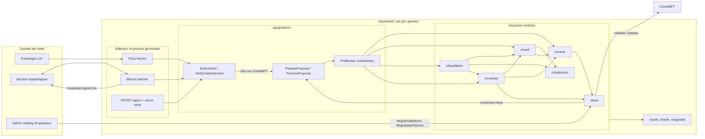
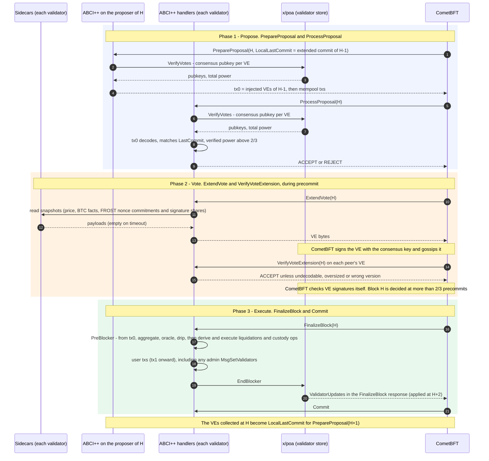
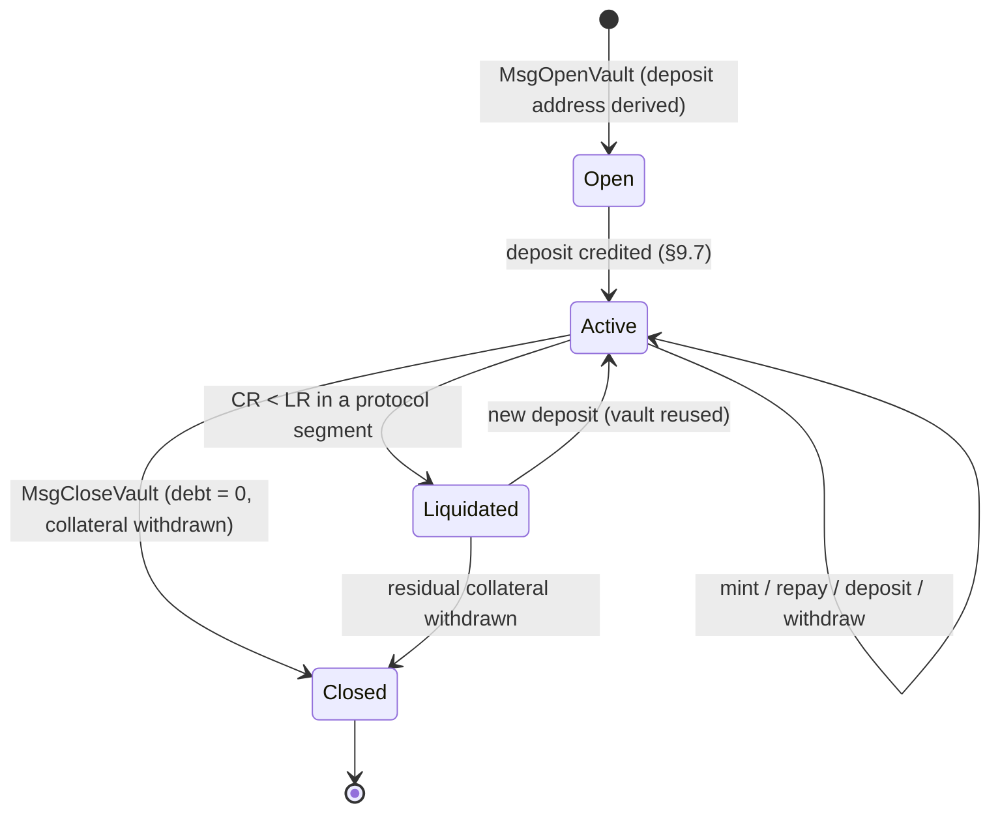
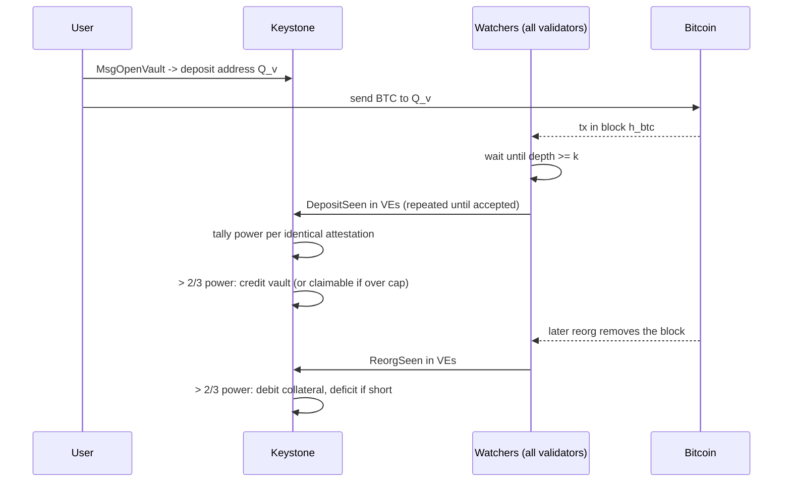
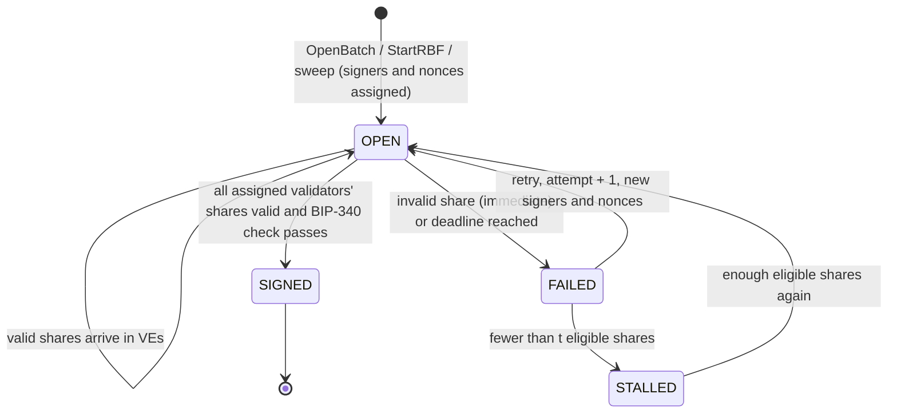
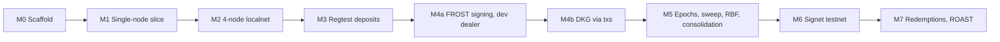

# Keystone: BTC-Backed Stablecoin Chain — Design Document

Oct 22, 2026 · @Rakesh

## 1. Overview

Keystone is a proof-of-authority Cosmos SDK chain run by a known group of operators. Users lock native BTC in a Taproot treasury controlled by the operators' FROST key and mint KUSD against it. Prices and custody signatures travel in vote extensions, so no external bridge, custodian, or oracle is involved; the operators themselves are the trusted party. Target: a 4-operator localnet on Bitcoin regtest, then a 7–20 operator testnet on signet.

**Change from the earlier draft:** the chain no longer uses proof of stake. There is no staking token (KEY is removed), no slashing, and no stake-weighted share mapping. The validator set is managed by an admin multisig of the operators through a small custom PoA module, `x/poa`. The Cosmos Enterprise PoA module was considered and rejected because its documentation states that vote extensions are not supported on PoA chains (§4.2).

**M7 change: back to proof of stake, on stock SDK modules.** The proof-of-authority federation is replaced by permissioned proof of stake: validators bond the native token `ukey` through `x/staking` (with `x/slashing`, `x/distribution`, `x/evidence` and `x/mint`), and only validators on the admin allowlist may join. The top N bonded validators with custody keys hold one FROST share each; a proven theft of treasury BTC slashes every share holder of the epoch. Gas stays zero; stakers earn `ukey` inflation and a share of KUSD stability fees. See §3, §4.2, §7.7, §9.2, §9.12 and ADRs 016–019. Sections that still say "operator" mean an allowlisted, bonded validator.

**Problem.** Borrowing dollars against BTC usually means trusting a custodian, a bridge, and an oracle network, often run by different parties. Keystone puts all three roles in one consortium of identified operators, each running its own node. Trust is explicit: more than 2/3 of operators honest for consensus, fewer than t of n colluding for custody, and custodied BTC capped by a hard limit (§3.2). This is a federated model, comparable to Blockstream's Liquid, not a permissionless one.

**Goals**

1. **G1 Native custody:** BTC sits in key-path Taproot outputs of the operators' FROST group key; no wrapped or transferable BTC token exists.
2. **G2 Zero-gas oracle:** BTC/USD enters state only through vote extensions, aggregated by a median.
3. **G3 Proposer-neutral liquidations:** the liquidation set and order are a pure function of committed state; deviating proposals are rejected.
4. **G4 Solvency:** KUSD is over-collateralized and the Appendix A invariants hold at the end of every block.
5. **G5 Bounded custody risk:** a hard treasury cap limits what a colluding operator majority could steal; membership changes are delayed so users can exit first.
6. **G6 Determinism:** no floats, map-order dependence, local clocks, or I/O inside state transitions.

**Non-goals:** a permissionless validator set, a native token or token economics, mainnet or audit (risky parts are flagged), non-BTC collateral, a transferable BTC token, IBC/EVM/CosmWasm, ROAST in v1 (retry-and-blame instead), a PSM, proposer neutrality for ordinary user transactions, post-quantum consensus keys.

**Fixed decisions**

| Decision | Value | Reason |
| --- | --- | --- |
| SDK / consensus | Cosmos SDK v0.55.0 with CometBFT v0.40.0 (latest releases, checked Oct 2026; SDK v0.55.0 pins CometBFT v0.40.0) | Newest supported release family |
| Validator set | Custom minimal `x/poa`: stored validator list, admin-only `MsgSetValidators`, EndBlocker validator updates; no `x/staking`, `x/distribution`, `x/slashing` | Enterprise PoA does not support vote extensions; ours keeps key lookup in step with CometBFT (§4.2) |
| Consensus key rotation | Not supported in v1; replace the operator instead | Avoids the window in which VE signatures cannot be verified |
| VE verification | Per-VE: unverifiable VEs are ignored; a block needs verified VEs from > 2/3 of power | One bad VE can never stall the chain (§5.4) |
| Admin | Multisig account of the operators, threshold > 2/3 (3-of-4 localnet) | Admin capture then needs the same collusion as custody theft |
| Language | Go everywhere, including FROST. Toolchain Go 1.27.3 (latest); go.mod minimum go 1.26.5, as SDK v0.55.0 requires | One toolchain; signer runs in-process |
| FROST implementation | RFC 9591 on `btcec/v2`, BIP-340 output; hand-written if no suitable Go library (VERIFY candidates) | Flagged for audit |
| Consensus keys | ed25519 only | Small VE signatures |
| Execution | Sequential (SDK default block-executor); BlockSTM and optimistic execution off | Simplest determinism argument |
| Operators / block time | 4 localnet, 7–20 testnet (supports up to 50) / \~3 s | §14 |
| Voting power | Exactly 1 per active operator, enforced by `x/poa` | Simple median and quorum math |
| Bitcoin | regtest → signet | No real value at risk |
| Treasury cap | 10 BTC hard cap, set by the admin | §3.2 |
| Tokens | KUSD only (`ukusd`, 6 decimals); collateral in satoshis; no native token | Working names |
| Fees | Zero gas price on localnet and testnet | No token needed to transact; spam risk accepted (§13) |
| Signer robustness | Retry-and-blame, ROAST-ready | Portfolio scope |
| Arithmetic | `sdkmath.Int`, RAY = 10^27 rate index | Determinism |

**Success criteria**

1. Zero app-hash divergence on a 4-node localnet over 10,000 randomized blocks with different local prices per node.
2. A fresh price commits in ≥ 99% of blocks, within 0.5% of an independent exchange median (measured off-chain by the test harness).
3. Every vault below the liquidation ratio is liquidated in the next block or queued deterministically; adversarial-proposer tests produce zero accepted deviating blocks.
4. Deposits credit within 5 blocks of reaching confirmation depth; withdrawals sign within 10 blocks with ≥ t honest operators online.
5. Zero nonce reuse under crash injection at every signing step.
6. Every Appendix A invariant holds at the end of every block in tests.

## 2. Glossary

H is a Keystone height; Bitcoin heights are h\_btc.

| Term | Meaning |
| --- | --- |
| **Operator** | An identified organization running one Keystone validator node, its own bitcoind, and its own FROST signer. |
| **Admin** | The multisig account of the operators (threshold > 2/3) that manages the validator set and all module parameters. |
| **PoA** | Proof of authority: the validator set and voting power are set by the admin, not by staked tokens. |
| **VE** | Vote extension: bytes a validator attaches to its precommit at H. Keystone's VE has three optional parts: price, Bitcoin attestations, FROST messages. |
| **Extended commit** | Precommits for H with their VEs and signatures, given to the H+1 proposer as `LocalLastCommit`. |
| **Injected pseudo-tx** | The serialized extended commit at tx index 0 of block H+1; not an `sdk.Tx`, consumed by the PreBlocker. |
| **Protocol segment** | Protocol work the PreBlocker does before user txs, all derived from tx0: oracle update → drip → liquidations → custody ops. |
| **P\_H** | Median price from height-H VEs, written to state in block H+1. |
| **CR / MCR / LR** | Collateral ratio; minimum ratio to mint or withdraw; ratio below which a vault is liquidated (LR ≤ MCR). |
| **art, rate** | Normalized debt and the cumulative RAY-scaled fee index; actual debt = art × rate. |
| **Stability pool** | User-deposited KUSD that absorbs liquidated debt in exchange for seized BTC. |
| **Surplus buffer / bad debt** | Protocol-owned KUSD from fees and penalties; debt left uncovered after a liquidation. |
| **Dust** | Minimum debt per vault. |
| **Treasury cap** | Maximum satoshis accepted into custody as collateral, set by the admin. |
| **n, t** | Number of operators in the custody set; FROST signing threshold, t = floor(2n/3) + 1. Each operator holds exactly one share. |
| **Key epoch** | Period during which one group key holds the treasury; ends when operator membership changes. |
| **Signing session** | One attempt at one signature over one fixed message by a fixed signer set. |
| **Nonce commitment** | Public (D, E) points published before signing; the secret nonces are single-use. |
| **Retry-and-blame / ROAST** | Exclude a faulty signer and restart; or run concurrent sessions that guarantee completion with t honest signers. |
| **Attestation** | A VE claim about a Bitcoin event, accepted only with a quorum of > 2/3 of voting power. |
| **k** | Bitcoin confirmation depth before Keystone treats a transaction as final. |
| **Sidecar** | Per-operator component outside consensus code: price fetcher, Bitcoin watcher, FROST signer. |

## 3. Threat model and trust assumptions

**From M7 Keystone is a permissioned proof-of-stake chain** (ADR-016–019). Validators bond the native token `ukey` through the stock SDK `x/staking`; only validators on the admin's allowlist may join. Keystone is safe while more than 2/3 of bonded power is honest and fewer than t of the N custody-set members collude. Above that, the treasury can be stolen; the deterrents are the custody set's slashable stake (§9.12), the validators' identity under the allowlist, and a hard cap on custodied BTC. The M0–M6 proof-of-authority text below is kept where it still applies; "operator" now means an allowlisted, bonded validator.

### 3.1 Assumptions

- **Consensus:** more than 2/3 of bonded voting power is honest. Power is stake (tokens ÷ `PowerReduction`) and is unequal. It protects block validity, oracle aggregation, liquidation enforcement and Bitcoin attestations, all of which already weight by power.
- **Custody:** fewer than t = floor(2N/3) + 1 members of the custody set collude. The custody set is the top N bonded validators by power that registered custody keys (§9.2), one share each. Localnet N = 4, t = 3; testnet N = 20, t = 14. Custody counts members, consensus counts stake, so the two thresholds no longer count the same thing (ADR-017).
- **Admin:** the admin multisig keeps parameters, upgrades and the validator allowlist. It is a fixed address set at genesis and replaced by `MsgUpdateParams`; its signers should be the custody-set organizations with a > 2/3 threshold.
- **How they interact:** consensus halts when more than 1/3 of power is offline; custody stalls when more than N − t members are offline. Safety differs: a consensus failure is detectable and recoverable; a custody failure moves BTC irreversibly.
- **Validators are known.** The allowlist admits identified organizations under an operating agreement. Misbehaviour is answered by slashing (double-sign, downtime, theft), by the admin removing the validator from the allowlist (which jails it), and off-chain.

### 3.2 Collusion of t or more custody members, slashing and the treasury cap

A t-coalition of the custody set can sign any Bitcoin transaction and drain the treasury. The protocol cannot stop the spend, and an aggregated Schnorr signature does not show which members signed. **Stake is the deterrent:** when > 2/3 of power attests that a treasury UTXO was spent by a transaction that is not a batch in committed state, every share holder of that UTXO's epoch is slashed by `TheftSlashFraction` (default 100%), jailed and tombstoned, and deposits pause (§9.12). Slashing at the epoch's activation height also reaches stake that started unbonding since then. Honest members are slashed too, which is why the custody set must trust each other's operations and why the slash covers the whole set.

The treasury cap bounds the loss. `TreasuryCapSat` = 10 BTC by default, set by the admin. The admin should keep it below the value of the stake a t-coalition would lose: the query `CustodyBond` reports the smallest bonded stake of any t members, in `ukey`. There is no on-chain `ukey` price, so the comparison is the admin's judgement (default assumption — review).

**Enforcement in `x/custody`**, evaluated every block in the PreBlocker:

1. A deposit that would push credited satoshis above `TreasuryCapSat` is recorded but not credited as collateral. It goes to the owner's claimable balance, usable only for withdrawal.
2. Withdrawals, repayments and liquidations are never blocked.
3. If the admin lowers the cap below current custody, deposits pause; nothing is force-withdrawn.

**Membership changes are delayed.** Adding operators can change who controls the next key. The new custody set takes over only after `MembershipDelayBlocks` (28,800 blocks, about 24 h on testnet; 100 on localnet) of a stable set. During the delay the change is visible on-chain and users can withdraw (§9.4).

### 3.3 Threats and mitigations

| Threat | Mitigation | Residual risk |
| --- | --- | --- |
| t or more operators collude to steal | Hard cap; identified operators; membership delay | Loss up to the cap |
| Admin multisig captured | Threshold > 2/3 of operators; membership delay lets users exit | Same as collusion |
| Oracle manipulation by fewer than 1/3 of operators | Median stays within the range of honest reports; per-block clamp and circuit breaker (§6.4) | Bias up to the spread of honest reports, typically < 0.1% |
| Shared exchange manipulated | At least 3 sources per operator with a local median; minting uses min(spot, TWAP) (§6.5) | A coordinated move across most major exchanges passes through |
| Proposer drops or reorders liquidations | Every node derives liquidations from tx0 and state; the block carries no list to alter (§8.6) | One lost round per faulty proposer |
| Proposer omits the VE injection | Injection is mandatory once VEs are enabled | None beyond a lost round |
| Proposer selectively includes VEs to bias the median | > 2/3 of power must be included; LastCommit binding (§5.4) | Bias up to the honest spread |
| Forged VEs | Each VE signature is verified against the extended commit | None |
| Malformed or oversized VEs | VerifyVoteExtension rejects only undecodable or oversized VEs; content is judged at aggregation | None |
| Withheld VEs | Count against participation; below quorum the price is held and staleness rules apply | Liquidations pause while the price is stale |
| Proposer censors user transactions | Proposer rotation | Delay of a few blocks |
| Transaction spam (zero fees) | Block gas limit; per-account rate limit in the ante handler (§5.6) | Degraded service during an attack |
| Bitcoin reorg shallower than k | Deposits credit only at depth k = 6 | None |
| Bitcoin reorg deeper than k | A > 2/3 attestation reverts the deposit; vault may be liquidated; shortfall becomes bad debt | Bad debt, absorbed by the surplus buffer |
| Eclipse attack on one operator's bitcoind | Bitcoin facts need > 2/3 of power to attest | Majority eclipse out of scope |
| Operator's signer offline or sending invalid shares | Share verification identifies the culprit; retry-and-blame excludes it; admin removes repeat offenders (§9.10) | Withdrawals wait while fewer than t operators are online |
| Nonce reuse through a bug or a restore from backup | Write-ahead nonce persistence, session binding, no nonce backups (§9.9) | Catastrophic if it happens: the share leaks. Flagged for audit |
| Equivocating signer | Shares verified against the published commitment | None |

**Out of scope:** more than 1/3 of operators faulty for consensus, attacks on secp256k1 or SHA-256, side channels on operator hosts, and attacks requiring control of the Bitcoin network.

## 4. Architecture

One Go binary (`keystoned`) per operator runs CometBFT, six custom modules (including a small `x/poa`), and three in-process sidecars (price fetcher, Bitcoin watcher, FROST signer) that talk to the ABCI handlers through narrow Go interfaces. The only external process is each operator's own `bitcoind`. Every sidecar interface is also defined as a gRPC service, so any sidecar can later move out of process without changing callers.

### 4.1 Component diagram



### 4.2 Modules

| Module | Owns | Depends on |
| --- | --- | --- |
| `x/admin` (M7; was `x/poa`) | Admin address, validator allowlist | auth, staking (jail) |
| SDK `x/staking`, `x/slashing`, `x/distribution`, `x/evidence`, `x/mint` (M7) | Bonded validators and power, validator updates to CometBFT, the validator store used for VE verification, downtime and double-sign slashing, rewards, `ukey` inflation | auth, bank |
| `x/oracle` | Committed spot price, TWAP ring buffer, price status, per-validator miss counters | staking (through `app/valset`) |
| `x/vault` | Vaults, global rate index, liquidation-price index, mint/repay/collateral messages | oracle, stablecoin |
| `x/stablecoin` | KUSD mint/burn authority, surplus buffer, bad debt (`sin`) | bank |
| `x/liquidation` | Stability pool, liquidation selection and execution, fallback Dutch auctions | vault, stablecoin, custody (claimable BTC) |
| `x/custody` | Key epochs, DKG, deposit addresses, attestation tallies, UTXO set, withdrawal queue and batches, FROST sessions, nonce-commitment pools, claimable balances, treasury cap, theft slashing | vault, oracle, staking (through `app/valset`), slashing |

The dependency graph is acyclic; `x/stablecoin` is a leaf apart from SDK modules. The earlier `x/treasurycap` module is folded into `x/custody`, since the cap is now a single admin-set number. `app/protocol` (not a module) owns the VE codec, aggregation, Prepare/Process handlers and the PreBlocker orchestrator, and calls keepers in the fixed order of §5.

**Authority.** Every Keystone module's `MsgUpdateParams`, `x/upgrade`, `x/consensus` and (M7) the `MsgUpdateParams` of `x/staking`, `x/slashing`, `x/distribution`, `x/mint` and `x/evidence` take the admin multisig address as their authority. The SDK keepers are built with the admin module address and their Msg services re-gated to the current admin (`app/authority.go`). `x/gov` is not used.

**M7: stock staking with an allowlist.** `x/poa` is retired. The SDK staking keeper is the validator store for VE verification (`GetPubKeyByConsAddr`) and the only source of validator updates; genesis validators come from `MsgCreateValidator` gentxs. The reason for the original custom module still holds for one feature: `MsgRotateConsPubKey` exists in SDK v0.55.0 staking and would make a rotating validator's VEs unverifiable for two heights, so an ante decorator rejects it (ADR-015). Other changes:

- **`x/admin`:** `Params{admin}` and `Allowlist: operator → AllowEntry{moniker, added_height}`. `MsgUpdateParams{admin, params}` replaces the admin. `MsgSetAllowlist{admin, add[], remove[]}`: removing a bonded validator jails it, after the custody removal guard approves (§9.4). An ante decorator lets `MsgCreateValidator` through only for allowlisted operators and rejects `MsgUnjail` for validators no longer allowlisted. Genesis: admin plus an allowlist that covers every gentx validator.
- **`app/valset`:** implements the oracle's and custody's `ValidatorSet` from staking state: bonded, unjailed validators with power > 0, sorted by operator address (the contract x/poa had); the operator account has the same bytes as the valoper address. Ranking by power happens only in custody's top-N selection (§9.2).
- **Rewards and fees:** see §7.7. Gas stays zero.

The history below (the M0–M6 custom PoA) is kept for reference.

**Change from the earlier draft: custom `x/poa` instead of the Enterprise PoA module (M0–M6).** The Enterprise module's architecture page states that vote extensions are not supported on PoA chains. The stated cause is consensus key rotation: for two heights the SDK's consensus address lags CometBFT's, so a rotating validator's VE signature cannot be verified. Keystone carries prices, attestations and FROST shares in VEs, so it needs a validator store that always matches CometBFT. A custom module also removes the license question.

**`x/poa` specification** (about 300 lines):

- **State:** `Params{admin}`; operator address → `Operator{consensus_pubkey (ed25519), moniker, power}`; consensus address → operator address (index); a set of used consensus pubkeys.
- **`MsgSetValidators{admin, entries[]{operator, consensus_pubkey, moniker, power}}`**, admin only. Rules: power is 0 or 1. A new operator must supply a pubkey never used before. An existing operator's pubkey cannot change (no rotation in v1; to change keys, remove the operator and add it again under a new operator address). Updates that the custody removal guard refuses are rejected (§9.4).
- **`MsgUpdateParams{admin, params}`**, admin only; this is how the admin itself is replaced.
- **EndBlocker:** compares stored powers with those last sent to CometBFT and returns `ValidatorUpdate`s for the difference (power 0 removes). CometBFT applies them two heights later.
- **Validator store:** implements `baseapp.ValidatorStore` (`GetPubKeyByConsAddr`, returning a CometBFT proto public key; confirmed in v0.55.0) and `TotalPower`. Records are never deleted, only set to power 0, so VEs from an operator's last heights before removal still verify.
- **Genesis:** admin address plus the initial operators at power 1.

The chain no longer depends on Cosmos Enterprise code. The PoA module's fee distribution is not replaced; with zero fees there is nothing to distribute.

**Keeper interfaces** (consumers declare these in their own `expected_keepers.go`):

```go
// x/oracle
type OracleKeeper interface {
    ApplyAggregate(ctx context.Context, agg oracletypes.Aggregate) error
    GetPriceState(ctx context.Context) (oracletypes.PriceState, error) // spot, last height, status
    LiquidationPrice(ctx context.Context) (sdkmath.Int, bool, error)  // spot; false if stale
    CollateralPrice(ctx context.Context) (sdkmath.Int, bool, error)   // min(spot, TWAP); false if stale
}

// x/vault
type VaultKeeper interface {
    Drip(ctx context.Context, blockTime time.Time) error
    GetVault(ctx context.Context, id uint64) (vaulttypes.Vault, error)
    Debt(ctx context.Context, v vaulttypes.Vault) (sdkmath.Int, error) // ceil(art*rate/RAY)
    // Iterates worst-first; stops at the first vault that is not liquidatable at price.
    IterateLiquidatable(ctx context.Context, price sdkmath.Int, fn func(vaulttypes.Vault) (stop bool)) error
    CloseForLiquidation(ctx context.Context, id uint64, seizeSat sdkmath.Int) (debt sdkmath.Int, err error)
    CreditCollateral(ctx context.Context, id uint64, sat sdkmath.Int) error
    DebitCollateral(ctx context.Context, id uint64, sat sdkmath.Int) error // reorg path, may go to deficit
}

// x/stablecoin
type StablecoinKeeper interface {
    Mint(ctx context.Context, to sdk.AccAddress, amt sdkmath.Int) error
    BurnFromModule(ctx context.Context, module string, amt sdkmath.Int) error
    AccrueSurplus(ctx context.Context, amt sdkmath.Int) error
    RecordBadDebt(ctx context.Context, amt sdkmath.Int) error
    CoverShortfall(ctx context.Context, to string, amt sdkmath.Int) (covered sdkmath.Int, err error)
}

// x/liquidation
type LiquidationKeeper interface {
    Select(ctx context.Context, price sdkmath.Int) (liqtypes.LiquidationBatch, error) // reads state only
    Execute(ctx context.Context, batch liqtypes.LiquidationBatch, price sdkmath.Int) error
}

// x/custody
type CustodyKeeper interface {
    BuildOps(ctx context.Context, agg custodytypes.Aggregate, blockTime time.Time) (custodytypes.CustodyBatch, error) // reads state only
    ApplyOps(ctx context.Context, batch custodytypes.CustodyBatch) error
    CustodiedSat(ctx context.Context) (sdkmath.Int, error)
    CapHeadroom(ctx context.Context) (sdkmath.Int, error)
    CreditClaimable(ctx context.Context, addr sdk.AccAddress, sat sdkmath.Int) error
}

// app/valset (x/staking), as seen by oracle and custody (M7; x/poa before)
type ValidatorSet interface {
    ActiveValidators(ctx context.Context) ([]types.Validator, error) // bonded, not jailed, power > 0, sorted by operator address
    TotalPower(ctx context.Context) (int64, error)                   // sum of their consensus power
    GetValidator(ctx context.Context, op sdk.AccAddress) (types.Validator, error) // any status; error if unknown
}
// types.Validator{OperatorAddress string, ConsAddress []byte, Power int64}: a local type in each module.
```

`Select` and `BuildOps` only read state and return a batch; the PreBlocker passes each batch straight to `Execute` or `ApplyOps`. Keeping derivation separate from execution makes both easy to unit-test.

### 4.3 Sidecars

All three run as goroutines inside `keystoned`, started by the app's server hooks and stopped on shutdown. ExtendVote never waits on the network: each sidecar keeps a snapshot updated in the background, and ExtendVote reads the snapshot with a 200 ms deadline. A missing or late snapshot yields an empty sub-payload, never an error.

| Sidecar | Does | Inputs | Output to ExtendVote |
| --- | --- | --- | --- |
| Price fetcher | Polls ≥ 3 exchanges every 1 s, takes the local median of quotes younger than 10 s | HTTPS REST | `OraclePayload` or empty |
| Bitcoin watcher | Follows its own bitcoind (RPC + ZMQ), scans blocks for registered deposit scripts, tracks credited and broadcast txs, estimates feerate, rebroadcasts signed txs from chain state | bitcoind, committed chain state | `BitcoinPayload` |
| FROST signer | Generates and persists nonces, publishes commitments, computes signature shares for sessions assigned on-chain, runs DKG rounds by submitting txs | share file, nonce store, committed chain state | `FrostPayload` |

```go
type PriceSource interface   { Snapshot() (*vetypes.OraclePayload, bool) }
type BitcoinWatcher interface { Snapshot(ctx context.Context, cs custodytypes.ChainView) *vetypes.BitcoinPayload }
type FrostSigner interface    { Payload(ctx context.Context, cs custodytypes.ChainView, height int64) (*vetypes.FrostPayload, error) }
```

`ChainView` is a read-only view of committed custody state (open sessions, assignments, registered scripts). The matching gRPC services (`keystone.sidecar.v1.Price`, `.Watcher`, `.Signer`) have one RPC per method above and are unused in the demo.

### 4.4 Key and share storage

| Secret | Location | Protection | Backup |
| --- | --- | --- | --- |
| Consensus key (ed25519) | `config/priv_validator_key.json` | Standard CometBFT, or cosmos-kms | Standard |
| Operator / custody tx key | Keyring (`os` or `file` backend) | Keyring passphrase | Standard |
| Custody encryption key (secp256k1, for DKG share encryption) | `custody/enc_key.json` | Argon2id + AES-256-GCM with operator passphrase | Encrypted offline copy |
| FROST secret shares | `custody/epoch_<n>/shares.json` | Same envelope | Encrypted offline copy per epoch |
| Nonce store | `custody/nonces.db` (bbolt, fsync on every write) | File permissions 0600 | **Never backed up or restored** (§9.9) |

The custody keys are separate from the consensus key so a consensus-key rotation (SDK v0.55) does not touch shares, and a leaked consensus key does not leak shares.

### 4.5 Sources of non-determinism and how each is removed

| Source | Rule |
| --- | --- |
| Map iteration | No Go maps in state-machine paths that affect output; iterate `collections` stores (ordered) or sort slices with a total order (`sort.SliceStable` plus tie-break on address or id) |
| Floats | Forbidden in `x/` and `app/protocol`; enforced by a lint rule. Amounts are `sdkmath.Int`; ratios use WAD (10^18) or RAY (10^27) fixed point with documented rounding |
| Time | Only the block header time (`ctx.BlockTime()`, `req.Time`); never `time.Now()` |
| External I/O | Only inside sidecars and ExtendVote, whose output is data validated by consensus. PrepareProposal reads only committed state and `LocalLastCommit` |
| Randomness | Only in the signer (nonces, DKG polynomials); never in state transitions |
| Concurrency | No goroutines in state-machine code; BlockSTM disabled |
| Encoding | Protobuf messages without `map` fields; repeated fields in canonical sorted order, checked on decode |
| Toolchain | Go version pinned in `go.mod` toolchain directive; reproducible builds in CI |
| Gas | Protocol segment runs under an infinite gas meter with work bounded by per-block caps, so gas accounting cannot diverge |

## 5. ABCI++ lifecycle

Data signed into VEs at height H is injected by the H+1 proposer as a single pseudo-tx, tx0. Every validator checks tx0 in ProcessProposal, and the PreBlocker derives and executes the oracle update, liquidations and custody operations from it before any user transaction. A proposer's only freedom is which valid VEs (above 2/3 of power) to include and which user transactions follow.

**Change from the earlier draft:** blocks no longer carry tx1 (liquidations) and tx2 (custody ops) for byte-for-byte comparison. Both were a pure function of tx0 plus committed state, so they added no information. They cost a second computation in ProcessProposal, a halt-on-mismatch path, and failed-transaction noise. Liquidations and custody ops are now derived and executed only in the PreBlocker; events record them for indexers.

### 5.1 One height, end to end



Every height runs the same five calls in this order: PrepareProposal, ProcessProposal, ExtendVote, VerifyVoteExtension, FinalizeBlock (then Commit). Vote extensions therefore lag by one height: the VEs created during height H are injected and executed in block H+1. ExtendVote at H runs before block H is executed, so a signer sees state committed at H−1. A FROST session opened while executing block B gets its shares in the VEs of height B+1, and they are aggregated while executing block B+2 (§9.8).

### 5.2 ExtendVote and VerifyVoteExtension

```go
type VoteExtHandler struct {
    price  PriceSource
    btc    BitcoinWatcher
    signer FrostSigner
    ck     custodykeeper.Keeper // read-only ChainView
}

func (h *VoteExtHandler) ExtendVote(ctx sdk.Context, req *abci.RequestExtendVote) (*abci.ResponseExtendVote, error) {
    ve := vetypes.VoteExtension{Version: 1, Height: req.Height}
    if p, ok := h.price.Snapshot(); ok { ve.Oracle = p }
    view := h.ck.ChainView(ctx)
    ve.Bitcoin = h.btc.Snapshot(ctx, view)
    if f, err := h.signer.Payload(ctx, view, req.Height); err == nil { ve.Frost = f }
    ve.Canonicalize()                 // sort repeated fields
    bz, err := ve.Marshal()
    if err != nil || len(bz) > MaxVEBytes { return &abci.ResponseExtendVote{VoteExtension: minimalVE(req.Height)}, nil }
    return &abci.ResponseExtendVote{VoteExtension: bz}, nil
}

func (h *VoteExtHandler) VerifyVoteExtension(ctx sdk.Context, req *abci.RequestVerifyVoteExtension) (*abci.ResponseVerifyVoteExtension, error) {
    var ve vetypes.VoteExtension
    if len(req.VoteExtension) > MaxVEBytes || ve.Unmarshal(req.VoteExtension) != nil ||
        ve.Version != 1 || ve.Height != req.Height || !ve.IsCanonical() || !ve.WithinCounts() {
        return &abci.ResponseVerifyVoteExtension{Status: abci.ResponseVerifyVoteExtension_REJECT}, nil
    }
    return &abci.ResponseVerifyVoteExtension{Status: abci.ResponseVerifyVoteExtension_ACCEPT}, nil
}
```

VerifyVoteExtension checks structure only. A rejected VE makes CometBFT discard that precommit, so rejecting on content (for example a price far from ours) would let a minority with odd data stall the chain. Content is judged during aggregation, where bad values are simply ignored. ExtendVote never returns an error. ExtendVote may run again in a later round of the same height; the signer returns identical nonces and shares for the same sessions (§9.9).

**Wiring:** `app.SetExtendVoteHandler` and `app.SetVerifyVoteExtensionHandler` on BaseApp (confirmed in v0.55.0, alongside SetPrepareProposal, SetProcessProposal and SetPreBlocker).

**Enable height:** set in genesis consensus params at `ABCI.VoteExtensionsEnableHeight` = 1 (path confirmed in CometBFT v0.40.0). ExtendVote runs from height 1. PrepareProposal first receives VEs at height 2, so tx0 first appears in block 2; block 1 has no tx0.

### 5.3 VE size budget

| Part | Typical | Cap |
| --- | --- | --- |
| Envelope (version, height) | 10 B | — |
| Oracle | 16 B | 32 B |
| Bitcoin: tip-minus-k ref, feerate, ≤ 16 attestations of \~90 B | 0.1–1.5 KB | 2 KB |
| FROST: nonce commitments (66 B each) and combined shares (32 B per session) | 0.3–3 KB | 12 KB |
| **Total (`MaxVEBytes`)** | **< 4 KB** | **16 KB** |

At 20 validators the injected commit is under 80 KB typically and 320 KB at the cap. Consensus `block.max_bytes` is set to 4 MB, and PrepareProposal subtracts tx0's size before filling with user txs.

### 5.4 Signature verification and binding to the commit

The injection tx carries the full `abci.ExtendedCommitInfo`, unchanged from `LocalLastCommit`. Keystone verifies it with its own function, `protocol.VerifyVotes`, instead of `baseapp.ValidateVoteExtensions`. The SDK helper fails the whole commit on the first bad signature (confirmed in the v0.55.0 source), so a single unverifiable VE would make every proposal fail. `VerifyVotes` checks each VE separately and simply ignores the ones that fail.

```go
// Deterministic: depends only on the injected bytes and committed x/poa state.
func VerifyVotes(ctx sdk.Context, vs ValidatorStore, chainID string, height int64,
    ext abci.ExtendedCommitInfo) (votes []VerifiedVote, verified, total int64) {
    for _, v := range ext.Votes { // order as given by CometBFT
        total += v.Validator.Power
        if v.BlockIdFlag != cmtproto.BlockIDFlagCommit || len(v.ExtensionSignature) == 0 {
            continue
        }
        pk, err := vs.GetPubKeyByConsAddr(ctx, sdk.ConsAddress(v.Validator.Address))
        if err != nil { continue } // unknown key: ignore this VE
        // Same sign-bytes construction as baseapp.ValidateVoteExtensions (confirmed in v0.55.0):
        // length-delimited CanonicalVoteExtension{extension, height, round, chain_id}.
        sb := voteExtSignBytes(chainID, height, ext.Round, v.VoteExtension)
        if !ed25519Verify(pk, sb, v.ExtensionSignature) { continue }
        votes = append(votes, VerifiedVote{ConsAddr: v.Validator.Address, Power: v.Validator.Power, VE: decodeVE(v.VoteExtension)})
        verified += v.Validator.Power
    }
    return votes, verified, total
}
```

**Acceptance rule:** a block is valid only if `verified × 3 > total × 2`. That stops a proposer from corrupting VEs to push participation below quorum. Individual bad VEs are ignored, so the chain can stall only if VEs from more than 1/3 of power cannot be verified at once. With `x/poa` and no key rotation that does not happen in normal operation.

Keystone also binds the injected commit to the block: the validators and `BlockIdFlag`s in the injected commit must match `req.ProposedLastCommit` (field confirmed in CometBFT v0.40.0). matchesLastCommit mirrors the SDK's unexported validateExtendedCommitAgainstLastCommit: same round, same number of votes, votes sorted by power descending then address ascending, no duplicates, and identical address and power at each position. The proposer therefore cannot pair the block's real LastCommit with a different set of votes.

### 5.5 Fewer than 2/3 of power with usable VEs

CometBFT only forms a commit from precommits whose VEs passed VerifyVoteExtension, so an injected commit always carries VEs from more than 2/3 of power. The case that matters is VEs that are valid but have an empty or unusable sub-payload, for example a price-fetcher outage. Each sub-payload has its own quorum:

| Sub-payload | Quorum | Below quorum |
| --- | --- | --- |
| Oracle | Reported power × 3 > total power × 2 (§6.3) | Price not updated; block counts toward staleness; liquidations continue on the last price until it is stale |
| Bitcoin attestation | Same content attested by ≥ 2/3 of total power, accumulated across heights | Tally stays pending until quorum or expiry |
| FROST shares | All signers assigned to the session | Session waits until its deadline, then retries (§9.10) |

User transactions and every module unrelated to the missing data keep running.

### 5.6 The injection pseudo-tx

tx0 is the 4-byte magic `KSTN`, the type byte `0x01`, then the protobuf body `InjectedVotes{extended_commit}`. It is present at index 0 in every block from the first height that has VEs to inject (enable height + 1), and absent before that.

- PrepareProposal drops any mempool tx that starts with the magic.
- ProcessProposal rejects a block with a magic-prefixed tx at any index other than 0.
- FinalizeBlock does not execute tx0: the Cosmos SDK vote-extension guide states that FinalizeBlock ignores byte slices that are not an `sdk.Tx`. Only the PreBlocker reads it (confirmed in v0.55.0: the decode failure is recorded as an error result for that tx, not a halt).
- User transactions start at index 1.

**Spam control with zero fees.** The ante handler rejects more than `MaxTxPerAccountPerBlock` = 5 user transactions from one signer in one block, and the consensus `block.max_gas` limit bounds total work. tx0 never passes through the ante handler.

### 5.7 PrepareProposal

```go
func (h *ProposalHandler) PrepareProposal(ctx sdk.Context, req *abci.RequestPrepareProposal) (*abci.ResponsePrepareProposal, error) {
    if !h.veActive(ctx, req.Height) { // no VEs from H-1 yet
        return &abci.ResponsePrepareProposal{Txs: h.userTxs(req.Txs, req.MaxTxBytes)}, nil
    }
    ext := req.LocalLastCommit // injected unchanged
    _, verified, total := protocol.VerifyVotes(ctx, h.poa, ctx.ChainID(), req.Height-1, ext)
    if verified*3 <= total*2 {
        // Should not happen: CometBFT already verified these signatures. Propose anyway
        // and log; peers will reject and the next round retries.
        h.logger.Error("verified VE power not above 2/3", "verified", verified, "total", total)
    }
    inj := encodeInjected(ext) // KSTN | 0x01 | InjectedVotes
    txs := append([][]byte{inj}, h.userTxs(req.Txs, req.MaxTxBytes-int64(len(inj)))...)
    return &abci.ResponsePrepareProposal{Txs: txs}, nil
}

// userTxs keeps mempool order, skips any tx carrying the magic prefix, and stops at maxBytes.
```

### 5.8 ProcessProposal

```go
func (h *ProposalHandler) ProcessProposal(ctx sdk.Context, req *abci.RequestProcessProposal) (*abci.ResponseProcessProposal, error) {
    reject := &abci.ResponseProcessProposal{Status: abci.ResponseProcessProposal_REJECT}
    if !h.veActive(ctx, req.Height) {
        for _, tx := range req.Txs {
            if hasMagic(tx) { return reject, nil }
        }
        return h.acceptUserTxs(ctx, req) // default handler checks on the rest
    }
    if len(req.Txs) == 0 { return reject, nil }
    for _, tx := range req.Txs[1:] {
        if hasMagic(tx) { return reject, nil }
    }
    ext, ok := decodeInjected(req.Txs[0])
    if !ok || !matchesLastCommit(ext, req.ProposedLastCommit) { return reject, nil }
    _, verified, total := protocol.VerifyVotes(ctx, h.poa, ctx.ChainID(), req.Height-1, ext)
    if verified*3 <= total*2 { return reject, nil } // bad VEs are ignored, not fatal
    return h.acceptUserTxs(ctx, req)
}
```

ProcessProposal checks only tx0 and never runs aggregation, liquidation or custody logic, so it is cheap and cannot disagree with an honest proposer: both run the same `VerifyVotes` on the same bytes. A rejection costs one round, not safety.

### 5.9 PreBlocker and FinalizeBlock

The app PreBlocker runs `x/upgrade`'s PreBlock first, then the orchestrator on the real (non-branched) state:

1. Decode tx0 (already validated by ProcessProposal) and run `VerifyVotes` to get the verified votes.
2. `protocol.Aggregate` the verified votes, then apply in order: `oracle.ApplyAggregate` → `vault.Drip` → `liquidation.Select` then `liquidation.Execute` → `custody.BuildOps` then `custody.ApplyOps` (including the treasury cap on newly credited deposits).
3. **Totality rule.** None of these steps may fail for any tx0 that passed ProcessProposal. An operation that cannot apply (a vault already closed, an invalid signature share, an attestation for an unknown script) is skipped and emits an event. FinalizeBlock cannot reject a block, so any error that does escape here is a bug: the node panics with the failing operation logged, and every node with the same code halts at the same point.

Blocksync and replay need nothing special: they re-execute the same PreBlocker on the same tx0 and reach the same state.

Then BeginBlock, the user txs (tx1 onward), and EndBlock run as usual. EndBlock asserts the Appendix A invariants in test builds.

## 6. Oracle

The committed price is the median of VE prices (power-weighted in code, a plain median here because every operator has equal power), updated only when reporters exceed 2/3 of total power, and clamped to ±5% per block. Liquidations use this clamped spot; minting and collateral withdrawals use the lower of spot and a 100-block average.

### 6.1 Schema and units

Prices are integer micro-USD per BTC: $100,000.00 is `100000000000`, well inside `uint64`.

```protobuf
// keystone/ve/v1/ve.proto
message VoteExtension {
  uint32         version = 1;   // = 1
  int64          height  = 2;   // must equal the vote height
  OraclePayload  oracle  = 3;   // absent = no price this height
  BitcoinPayload bitcoin = 4;   // §9
  FrostPayload   frost   = 5;   // §9
}
message OraclePayload {
  uint64 price_micro_usd = 1;  // local median, > 0
  uint32 num_sources     = 2;  // quotes used in the local median
}

// keystone/oracle/v1/state.proto
message PriceState {
  string spot_micro_usd       = 1 [(cosmos_proto.scalar) = "cosmos.Int"];
  string last_median_micro_usd = 2 [(cosmos_proto.scalar) = "cosmos.Int"];
  int64  last_update_height   = 3;
  string twap_micro_usd       = 4 [(cosmos_proto.scalar) = "cosmos.Int"];
  PriceStatus status          = 5; // ACTIVE, VOLATILE, STALE
  string prev_spot_micro_usd  = 6 [(cosmos_proto.scalar) = "cosmos.Int"]; // spot before the last update (invariant 9; added in M1)
}
```

### 6.2 Sources per operator

Each operator configures at least 3 independent BTC/USD sources (for example Coinbase, Kraken, Bitstamp, Gemini). The fetcher polls each every second, drops quotes older than 10 s, and reports the median of the rest with `num_sources`. Fewer than `MinSources = 3` fresh quotes means no oracle payload. Source lists are deliberately not set on-chain, so validators diversify. On localnet, every fetcher reads a controllable mock HTTP feed so tests can script crashes.

### 6.3 Aggregation

```go
// Called inside protocol.Aggregate. votes are VEs whose signatures already verified.
func AggregatePrice(votes []VerifiedVote, totalPower int64, prev PriceState, p Params) PriceAggregate {
    type obs struct{ price uint64; power int64; addr []byte }
    var xs []obs
    var reported int64
    for _, v := range votes {
        o := v.VE.Oracle
        if o == nil || o.PriceMicroUsd == 0 || o.NumSources < p.MinSources { continue }
        xs = append(xs, obs{o.PriceMicroUsd, v.Power, v.ConsAddr})
        reported += v.Power
    }
    agg := PriceAggregate{ReporterAddrs: addrsOf(xs)}
    if reported*3 <= totalPower*2 { return agg } // Updated = false

    sort.SliceStable(xs, func(i, j int) bool {
        if xs[i].price != xs[j].price { return xs[i].price < xs[j].price }
        return bytes.Compare(xs[i].addr, xs[j].addr) < 0
    })
    var cum int64
    for _, o := range xs {
        cum += o.power
        if cum*2 >= reported { agg.Median = o.price; break }
    }
    agg.Spot = agg.Median
    if !prev.Spot.IsZero() { // no clamp at bootstrap
        lo := prev.Spot.MulRaw(10000 - p.MaxStepBps).QuoRaw(10000)
        hi := prev.Spot.MulRaw(10000 + p.MaxStepBps).QuoRaw(10000)
        agg.Spot = clampInt(sdkmath.NewIntFromUint64(agg.Median), lo, hi)
    }
    agg.Updated = true
    return agg
}
```

`totalPower` is the sum of `Validator.Power` over every entry of the injected commit, including absent validators. Integer multiplication avoids division in the quorum test.

**Why reporters must exceed 2/3 of power.** Byzantine power f is below 1/3 of total. The median is honest-bounded only if byzantine reporters are under half of reported power, which needs reported > 2f, so more than 2/3 of total. With a 50% threshold, 1/3 byzantine reporters could be two thirds of the reports and set the price.

**Example.** Four operators report, each with power 1 (total 4):

| Operator | Price (USD) | Cumulative power, sorted by price |
| --- | --- | --- |
| C | 99,990 | 1 |
| A | 100,020 | 2 ← first with 2 × 2 ≥ 4 |
| B | 100,050 | 3 |
| D (faulty) | 150,000 | 4 |

The median is $100,020 (the lower median); the $150,000 report has no effect. With a previous spot of $99,800, the ±5% clamp band is $94,810–$104,790, so the spot is $100,020.

### 6.4 Staleness, deviation and circuit breaker

| Parameter | Value | Effect |
| --- | --- | --- |
| `MaxStepBps` | 500 (5%) | Per-block clamp of spot against previous spot; a 30% crash takes 7 blocks (\~21 s) to show |
| `StaleBlocks` | 20 (\~60 s) | No update for this many blocks → `STALE`: liquidations, mints and collateral withdrawals pause; repay, deposit and stability-pool deposits continue |
| `TwapBlocks` | 100 (\~5 min) | Block-weighted mean of spot over the last 100 blocks (a stale block repeats the last spot); equals a time-weighted mean at steady 3 s blocks |
| `VolatileBps` | 1500 (15%) | \|spot − TWAP\| > 15% of TWAP → `VOLATILE`: new mints pause; liquidations continue |

Status is recomputed every block in `oracle.ApplyAggregate`, including blocks without an update.

### 6.5 Spot versus TWAP

| Decision | Price used | Why |
| --- | --- | --- |
| Liquidation | Clamped spot | A TWAP lags a crash and turns undercollateralized vaults into bad debt; the clamp bounds the effect of any one block |
| Mint, collateral withdrawal | min(spot, TWAP) | Valuing collateral at the lower price stops a brief spike from being borrowed against |
| Treasury cap | Spot | Cap tightening should be immediate |
| Redemptions (v2) | max(spot, TWAP) | Redeemers receive fewer sats when prices disagree |

**Residual risk:** a one-block 5% downward manipulation can liquidate vaults with collateral ratio between 130% and about 136.8% (130 ÷ 0.95). It requires either more than 1/3 of operators or a coordinated move on most configured exchanges.

### 6.6 Penalties

- A **miss** is a block where the operator's VE was included but had no oracle payload, or reported a price more than 2% from that block's median.
- Misses are counted over a sliding window of 1,000 blocks in a bit array per validator.
- More than 200 misses (20%) in the window emits `oracle_miss_threshold` and raises an alert; the window then resets.
- There is no automatic jailing or slashing; `x/poa` has neither. The admin decides whether to remove the operator with `MsgSetValidators` (power 0).
- Slashing for outliers would be wrong anyway: honest operators can report outliers through source failures, and punishing them would push everyone onto identical sources.

### 6.7 Empty VEs during partial outages

An empty oracle payload is valid and counts as a miss. If at least 2/3 of power still reports, the price updates from the remaining reporters. If not, the price is held, the block counts toward `StaleBlocks`, and the protocol pauses only the actions that need a fresh price (§6.4).

## 7. Stablecoin and vault economics

Vaults follow MakerDAO's model (normalized debt × a cumulative rate index), with a 150% minting ratio, a 130% liquidation ratio, a 10% liquidation penalty and a 2% annual stability fee. Fees mint into a surplus buffer that absorbs bad debt first. The v1 peg relies on over-collateralization, the stability fee and stability-pool demand; Liquity-style redemptions come in v2, and a PSM is rejected.

### 7.1 Parameters

| Parameter | Value | Note |
| --- | --- | --- |
| `MinCollateralRatio` (MCR) | 15000 bps | Required after mint or collateral withdrawal, at `CollateralPrice` |
| `LiquidationRatio` (LR) | 13000 bps | Liquidated when below this, at `LiquidationPrice` |
| `LiquidationPenalty` | 1000 bps | Paid to whoever absorbs the debt |
| `StabilityFeePerSecond` | 1000000000627937192491029810 (RAY) | 1.02^(1/31,536,000), i.e. 2% per year |
| `GlobalDebtCeiling` | 500,000 KUSD | 10 BTC at $100,000 supports at most \~666,667 KUSD at MCR |
| `Dust` | 100 KUSD | Minimum non-zero debt per vault |
| `MinDepositSat` | 10,000 sat | Smaller deposits go to the fee reserve, not the vault |

Amounts: KUSD in `ukusd` (10^-6), BTC in satoshis, prices in micro-USD per BTC, ratios in basis points.

### 7.2 Vault lifecycle



Checks per message:

| Message | Requires |
| --- | --- |
| `MsgMint` | Owner; price status `ACTIVE`; debt after ≥ `Dust`; total debt ≤ ceiling; CR after ≥ MCR at min(spot, TWAP) |
| `MsgRepay` | Anyone; remaining debt is 0 or ≥ `Dust` |
| `MsgWithdrawCollateral` | Owner; status not `STALE`; CR after ≥ MCR (or debt = 0); amount ≥ 10,000 sat |
| `MsgCloseVault` | Owner; debt = 0; withdraws all collateral |

### 7.3 Stability-fee accrual

For each vault, `art` is normalized debt; the global `rate` starts at 1 RAY and only rises.

```latex
\text{rate}_{new} = \left\lfloor \frac{\text{rate}_{old}\cdot \text{rpow}(f, \Delta t)}{RAY} \right\rfloor,\qquad \Delta t = \lfloor t_{block} - t_{lastDrip} \rfloor \text{ seconds}
```

- `rpow` is exponentiation by squaring in RAY with half-up rounding, as in MakerDAO's `jug`.
- Drip runs once per block in the PreBlocker, before liquidation selection, using header time only.
- Fee revenue: `floor(totalArt × (rate_new − rate_old) / RAY)` KUSD is minted to the surplus buffer.
- Vault debt = `ceil(art × rate / RAY)`.
- Mint d: `art += ceil(d × RAY / rate)`. Repay r: `art −= floor(r × RAY / rate)`, or `art = 0` when r equals the full debt.
- Every rounding favors the protocol; the resulting gap is bounded in Appendix A.

### 7.4 Surplus buffer and bad debt

`x/stablecoin` holds two balances:

- **Surplus** (module account `surplus`): KUSD from stability fees.
- **Bad debt** (`sin`): debt removed from a vault without KUSD being burned. It comes from fallback auctions (§8.4) and deep Bitcoin reorgs (§9.7).

Every block, `Heal` burns min(surplus, sin) from surplus and reduces sin by the same amount. If sin stays above 5% of KUSD supply for 1,000 blocks, mints pause and an event alerts the admin. With no native token there is no token-dilution backstop (MakerDAO's `flop`); a production deployment would need operator recapitalization or an insurance fund (§20).

### 7.5 Peg mechanisms

| Mechanism | Verdict | Reason |
| --- | --- | --- |
| Over-collateralization + liquidations | v1 | Keeps every unit backed |
| Stability fee (admin-set) | v1 | Slow but simple; raising it shrinks supply |
| Stability pool yield | v1 | Liquidation gains create steady demand for KUSD below $1 |
| Debt ceiling | v1 | Bounds exposure; tied to the 10 BTC treasury cap |
| Redemptions (Liquity) | v2 | Hard floor near $1 minus the fee. Each redemption becomes a Bitcoin withdrawal, so it needs working custody batching first. Plan: minimum 500 KUSD, 0.5% base fee, against the lowest-CR vaults, priced at max(spot, TWAP) |
| PSM | Rejected | Needs a custodial stablecoin as reserve, which reintroduces a trusted issuer |

Above $1, minting and selling KUSD is profitable at MCR 150%, which caps the upside loosely.

### 7.6 Worked examples

**Open.** Alice opens vault 7 and deposits 0.5 BTC (50,000,000 sat) at spot = TWAP = $100,000.

- Collateral value $50,000; maximum mint at 150% is 33,333.33 KUSD.
- She mints 30,000 KUSD: art = 30,000 (rate = 1.0), CR = 166.7%.

**Accrue.** After 30 days (2,592,000 s):

- rate = 1.0016289 RAY.
- Debt = 30,048.87 KUSD; 48.87 KUSD was minted to surplus over those blocks.
- Liquidation price = 1.30 × 30,048.87 ÷ 0.5 = $78,127.06.

**Liquidate (stability pool).** The committed spot reaches $76,000; CR = 38,000 ÷ 30,048.87 = 126.5% < 130%.

- Vault 7 is in the next block's liquidation batch. The stability pool holds 200,000 KUSD, enough to absorb it.
- Pool burns 30,048.87 KUSD.
- Seized = ceil(30,048.87 × 1.10 ÷ 76,000 × 10^8) = 43,491,783 sat ($33,053.76), credited pro rata to pool depositors, a $3,004.89 gain.
- Alice keeps 6,508,217 sat ($4,946.24) in vault 7 with zero debt. 33,053.76 + 4,946.24 = 38,000.

**Liquidate (fallback, with bad debt).** Same vault, but the stability pool holds less than 30,048.87 KUSD.

- 30,048.87 moves to sin; all 0.5 BTC goes to a Dutch auction targeting 33,053.76 KUSD.
- The price keeps falling, and the auction sells all 0.5 BTC for 29,000 KUSD (average $58,000).
- 29,000 KUSD is burned; sin = 1,048.87.
- The surplus buffer (5,000 KUSD) heals it: surplus 3,951.13, sin 0. Alice receives nothing back.

### 7.7 Staking rewards and fees (M7)

- **Gas stays zero.** Users need only KUSD; the per-account rate limits of the ante handler stay the spam defence (ADR-019). Validators set `minimum-gas-prices` to zero.
- **Inflation:** stock `x/mint` mints `ukey` each block into the fee collector; `x/distribution` pays it to validators and delegators by stake, after commission. Mint parameters are admin-set.
- **KUSD share:** `x/stablecoin` param `StakerShareBps` (default 2,000 = 20%, bounds 0–5,000). Each block, that share of the stability fees accrued into the surplus buffer in that block, rounded down, moves from the surplus buffer to the fee collector, so `x/distribution` pays KUSD to stakers. The remainder stays in the surplus buffer. Bad debt is never paid out: while `sin` > 0 the share is zero and the whole accrual heals `sin` first.
- **Slashed `ukey`** is burned (stock `x/staking` behaviour).

## 8. Deterministic liquidations

Each block liquidates up to 50 vaults, worst collateral ratio first, chosen by walking an index of normalized debt-to-collateral ratios against the freshly committed price. The stability pool absorbs each vault when it holds enough KUSD; otherwise a Dutch auction sells the collateral. The batch is a pure function of committed state, the injected VEs and header time, and every node computes it in the PreBlocker, so the proposer has no say in it.

### 8.1 Liquidation index

All vaults share one rate index, so ordering by liquidation price is the same as ordering by `art / collateral`. The index stores a rate-independent key and never needs re-sorting when fees accrue.

```go
// ratio = art * WAD / collateralSat   (collateralSat == 0 => maximal ratio)
// key   = (MaxUint256 - ratio) as 32-byte big-endian || vaultID as 8-byte big-endian
// Ascending iteration yields the highest ratio (worst CR) first; ties break by lower vault ID.
var LiqIndex = collections.NewMap(sb, LiqIndexPrefix, "liq_index",
    collections.PairKeyCodec(collections.BytesKey, collections.Uint64Key), collections.BoolValue)
```

- The entry is rewritten on every change to a vault's `art` or collateral: mint, repay, deposit, withdrawal, liquidation, reorg debit.
- Vaults with `art = 0` are not indexed.
- Fee accrual changes `rate` only, so no index writes are needed.

**Exact test** for a vault at committed price P (micro-USD per BTC), done in integers:

```latex
\text{liquidatable} \iff \text{collSat}\cdot P \cdot 10^4 < LR_{bps}\cdot \text{debt}\cdot 10^8,\qquad \text{debt} = \lceil \text{art}\cdot\text{rate}/RAY \rceil
```

### 8.2 Selection rule

```go
// Runs in the PreBlocker after oracle.ApplyAggregate and vault.Drip.
func (k Keeper) Select(ctx context.Context, price sdkmath.Int) (liqtypes.LiquidationBatch, error) {
    batch := liqtypes.LiquidationBatch{PriceMicroUsd: price}
    if !k.oracle.IsActiveForLiquidation(ctx) { return batch, nil } // STALE: empty batch
    p := k.Params(ctx)
    poolLeft := k.PoolBalance(ctx)
    err := k.vault.IterateLiquidatable(ctx, price, func(v vaulttypes.Vault) (stop bool) {
        if len(batch.Entries) == int(p.MaxPerBlock) { return true }
        debt := k.vault.MustDebt(ctx, v)
        mode := liqtypes.MODE_POOL
        if poolLeft.LT(debt) {
            mode = liqtypes.MODE_AUCTION
        } else {
            poolLeft = poolLeft.Sub(debt)
        }
        batch.Entries = append(batch.Entries, liqtypes.Entry{VaultId: v.Id, Mode: mode})
        return false
    })
    return batch, err
}
```

`IterateLiquidatable` walks the index in ascending key order and stops at the **first** vault that fails the exact test. That stopping rule is part of the definition: a vault misordered by rounding at the boundary is simply picked up next block. There is no separate carry-over queue; vaults beyond the per-block cap remain at the front of the index and are selected next block.

### 8.3 Per-block cap

| Item | Value |
| --- | --- |
| `MaxPerBlock` | 50 |
| State ops per liquidation | \~40 reads and writes (vault, index, pool scalars, bank burn) |
| Time per liquidation | < 1 ms on commodity hardware → < 50 ms per block |
| Block space | None: the batch is derived, not carried in the block |

The protocol segment runs with an infinite gas meter, so the cap is the only bound. 50 per block is 1,000 per minute at 3-second blocks, above the testnet's plausible vault count.

### 8.4 Mechanism

|  | Stability pool (Liquity) | Dutch auction (MakerDAO Liquidations 2.0) |
| --- | --- | --- |
| Needs outside actors | No; executes inside the protocol segment | Yes; takers submit `MsgTakeCollateral` |
| Proposer influence | None | Ordering of competing take txs (normal MEV) |
| Latency | Same block | Minutes |
| Fails when | Pool too small | No takers or thin liquidity |
| Collateral sold on markets | No | No, sold to takers on-chain |

**Recommendation:** stability pool first, Dutch auction as fallback. The pool keeps the common path fully deterministic and keeper-free; the auction covers pool exhaustion. Mode is per vault and all-or-nothing: the pool takes the whole vault or none of it.

**Pool mode** (per entry, in batch order):

1. Debt D; seize S = min(collateral, ceil(D × (10,000 + penalty\_bps) × 10^8 ÷ (10,000 × P))) sats.
2. Burn D from the pool. Credit S to depositors pro rata using Liquity's product-sum scalars (P for compounding deposit loss, S for collateral gain per unit, with Liquity's scale-change logic for precision). **Flag for audit:** Liquity had precision bugs in this exact code.
3. If S × P < D (the vault was under 100%), move up to D − S × P of KUSD from surplus to the pool; any remainder is a loss to pool depositors.
4. Vault: `art = 0`; remaining collateral stays with the owner.

**Auction mode:**

1. Move D to `sin`; move all collateral into auction `a` with `tab = D × (1 + penalty)`.
2. Starting price = spot × 1.20; each block the price is multiplied by 0.99. If it falls below 60% of start or 300 blocks pass, the auction resets at current spot × 1.20.
3. `MsgTakeCollateral{auction_id, max_sat, max_price}` pays KUSD at the current price and credits the taker's claimable BTC balance. The paid KUSD is burned against `sin`.
4. Once proceeds reach `tab`, leftover collateral returns to the vault. Unmet `sin` is healed by surplus (§7.4).

**Keeper incentives:** pool liquidations need no keeper; the protocol triggers them and pays no gas. Auction takers earn the discount. There is no kick reward, because no one needs to kick.

**Claimable BTC:** pool gains and auction purchases are credited as internal satoshi balances per account. Owners withdraw them through the normal withdrawal path (§9.8) or move them into a vault with `MsgDepositClaim`, which needs no Bitcoin transaction.

### 8.5 Cascades and bad debt

- Liquidations do not move the oracle price: there is no on-chain market and the pool sells nothing, so an in-chain price-impact spiral is impossible.
- Outside cascades (takers and pool depositors selling BTC on exchanges) are damped by the 5% clamp, the 50-per-block cap, and the pool absorbing without selling.
- Bad debt order: surplus buffer, then `sin` stays open and mints pause above 5% of supply (§7.4).

### 8.6 Why a byzantine proposer cannot skip, add or reorder liquidations

Let `Derive(S_H, I, t)` be the function computing the liquidation batch from committed state `S_H` (identical on all nodes via the app hash), injected votes `I` (tx0), and header time `t`.

1. `Derive` is deterministic: no floats, maps, I/O or local time (§4.5), and every iteration has a total order.
2. Every node runs `Derive` in the PreBlocker on `(S_H, I, t)` and executes the result directly. The block contains no liquidation list, so there is nothing a proposer could skip, add or reorder.
3. The proposer's only inputs are `I` and `t`. ProcessProposal constrains `I`: valid signatures, verified VEs above 2/3 of power, and a match with the block's real LastCommit (§5.4). CometBFT's time rules constrain `t`.
4. A node that computed a different batch would reach a different app hash and halt. That can only come from a determinism bug, which the multi-node harness (§15) is built to catch.

**Remaining proposer influence:**

- **Which VEs to inject.** The proposer chooses among valid VEs above 2/3 of power, which moves P within the honest spread (§3.3). Only vaults whose liquidation price falls inside that spread are affected.
- **Header time.** This shifts drip by a few seconds at most, a fraction of a basis point of fees.

The proposer can also decline to propose, which costs only a round.

## 9. Bitcoin custody with FROST

All active operators form the custody set, and each holds one FROST share, with threshold t = floor(2n/3) + 1. Each membership change gets a fresh key from a Pedersen DKG run through transactions, followed by a sweep of funds, after a delay that lets users exit. Deposits are attributed by per-vault Taproot tweaks and credited on a > 2/3 attestation at depth 6. Withdrawals are batched into deterministic transactions whose per-input FROST sessions run in vote extensions, finishing about 3 blocks after a batch opens.

**Change from the earlier draft:** the stake-weighted custody set (top 20 validators, 400 virtual shares, t = 267) is replaced by one share per operator, and key epochs now end on membership changes rather than on a fixed schedule.

**M7 change:** the custody set is the top N bonded validators by power that registered custody keys (`CustodySetSize`, default 20), still one share each (§9.2). A proven theft slashes the whole set (§9.12).

### 9.1 Parameters

| Parameter | Localnet | Testnet | Note |
| --- | --- | --- | --- |
| Custody set | 4 validators | Top N = 20 bonded validators by power (`CustodySetSize`) | Bonded, unjailed, custody key registered; incumbents kept within `CustodyEntryMarginBps` (§9.2) |
| Shares | 1 per member | 1 per member | Share index = rank by operator address, from 1 |
| Threshold t | 3 | floor(2N/3) + 1: 14 at N = 20 | Strictly more than 2/3 of members |
| `CustodyEntryMarginBps` | 1,000 | 1,000 (10%) | An outsider displaces the weakest incumbent only above this margin |
| `MinCustodySelfBond` | 1 `ukey` | Admin-set | Self-bond a member of a funded epoch cannot undelegate below |
| `TheftSlashFraction` | 1.0 | 1.0 | Slash on an attested unauthorized spend (§9.12) |
| `MembershipDelayBlocks` | 100 | 28,800 (\~24 h) | Before a changed set takes custody |
| Confirmation depth k | 1 | 6 | regtest mines on demand |
| Nonce pool per operator | 8 | 8 | Preprocessed commitments |
| Session deadline | 5 blocks | 5 blocks | Then retry |
| Max inputs per tx | 8 | 8 | One FROST session per input |

### 9.2 Operators and shares

Every operator has power 1 and exactly one share, so the custody threshold and the consensus threshold count the same thing. A coalition of 2n/3 operators or fewer cannot sign; signing needs t operators online, essentially the same bar as consensus liveness. `x/poa` only accepts power 0 or 1, so the two thresholds cannot drift apart.

The earlier virtual-share mapping is no longer needed. It existed only to approximate stake weighting with unweighted FROST.

**M7: top N by power, one share each.** Power is now stake and unequal, while FROST still counts signers. The custody candidates are computed every EndBlock:

1. Take the active validators (bonded, unjailed, power > 0) that registered custody keys.
2. Rank them by power descending, then operator address ascending.
3. Incumbents are the share holders of the ACTIVE epoch. Walking the ranking, an incumbent keeps its seat; an outsider takes a seat only while seats remain, or by displacing the weakest remaining incumbent when its power exceeds that incumbent's by more than `CustodyEntryMarginBps`. This hysteresis stops small stake movements from triggering a new key.
4. Take N members; the set is sorted by operator address for share indices, as before.

Each member holds one share and t = floor(2N/3) + 1. Custody therefore counts members while consensus counts stake: a few large validators can hold more than 2/3 of power with fewer than t shares, and t small ones can hold less (ADR-017). The bound on a theft is the custody set's slashable stake (§9.12) and the treasury cap (§3.2). Signing liveness needs t members online and in the active validator set, since shares travel in VEs; `MaxValidators` (50) is kept well above N.

### 9.3 DKG (genesis and each membership change)

Pedersen DKG with proofs of knowledge, as in the FROST paper (Komlo and Goldberg, 2020). Each operator is one dealer of a degree-(t−1) polynomial and receives the evaluation at its own index. DKG messages travel in ordinary transactions signed by a custody hot key, not in VEs. They are rare and not latency-sensitive, and keeping them out of VEs keeps the VE budget small (about 2 KB per dealer at n = 20).

1. **Commit** (window of 20 blocks): `MsgDKGCommit{epoch, coeff_commitments[t], pok}`. The proof of knowledge is a Schnorr proof of a₀ bound to (chain id, epoch, dealer).
2. **Deal** (20 blocks): `MsgDKGDeal{epoch, ciphertexts[]}`, one per recipient. Each holds f\_v(i), encrypted with ECDH to the recipient's registered custody encryption key, HKDF-SHA256, then AES-256-GCM with associated data (epoch, dealer, recipient).
3. **Complain** (20 blocks): each recipient checks f\_v(i)·G = Σ\_j iʲ·C\_{v,j}. If the check fails, it submits `MsgDKGComplaint{dealer, ecdh_secret, dleq_proof}`. The chain decrypts, verifies, and disqualifies the dealer if the complaint holds, or the complainer if it does not.
4. **Finalize:** with qualified dealers Q, group key Y = Σ\_{v∈Q} C\_{v,0}, and aggregated commitments C\_j = Σ\_{v∈Q} C\_{v,j}. Verifying shares Y\_i = Σ\_j iʲ·C\_j for every operator are computed in EndBlock (n × t scalar multiplications, under 50 ms at n = 20). If |Q| is below 2/3 of operators, the DKG restarts once, then alerts.
5. Every operator derives its share s\_i = Σ\_{v∈Q} f\_v(i), checks s\_i·G = Y\_i, encrypts it to disk (§4.4), and the epoch becomes `ACTIVE`.

At genesis the custody state is empty: the epoch-1 DKG starts at height 2, and deposits stay disabled until epoch 1 is `ACTIVE` (about 60 blocks). **Flag for audit:** DKG, complaint handling and DLEQ proofs.

**Dev shortcut (milestone M4a only):** a `--dev-dealer` genesis flag where one process generates and distributes shares. It is rejected by the binary when the chain id is not a localnet id.

**Implementation notes (M4b).**

- Custody keys: each operator has a secp256k1 encryption key (`<home>/custody/enc_key.json`, Argon2id + AES-256-GCM) and a custody hot key (keyring name `custody`), created by `keystoned custody init` or `testnet init-files`. Genesis carries `custody_keys{operator, enc_pubkey, hot_key}`; operators added later send `MsgRegisterCustodyKey`. The hot key is accepted directly by x/custody (state 0x18 operator → key, 0x22 hot key → operator); x/authz is not added (default assumption — review). A hot key serves one operator.
- Participants are the active operators with custody keys, share index = rank by operator address; t = ⌊2n/3⌋ + 1. With no epoch at all, x/custody's EndBlock of height 1 opens the epoch-1 run at height 2: commit [2, 22), deal [22, 42), complain [42, 62); finalization runs in the EndBlock of height 61.
- Commit: t coefficient commitments and a proof of knowledge (frost-core's Schnorr proof, Taproot encoding) whose challenge is HDKG(chain_id ‖ epoch (8 bytes BE) ‖ id ‖ C₀ ‖ R): bound to chain, epoch and dealer index (A9). A bad proof is rejected on submission; one commitment per dealer.
- Deal: one ciphertext per other participant, by recipient index; ciphertext = nonce (12 random bytes) ‖ AES-256-GCM(share), key = HKDF-SHA256(ikm = ECDH point S = x_dealer·X_recipient compressed, info = "Keystone/dkg-share" ‖ ad), ad = epoch (8) ‖ dealer index (4) ‖ recipient index (4).
- Complaint: S with a DLEQ proof (c ‖ z, challenge H_tag("Keystone/dleq", X ‖ D ‖ S ‖ R1 ‖ R2)) that log_G(X_complainer) = log_D(S) for the dealer's key D; an invalid proof is rejected. The chain derives the key, decrypts and checks f_v(i)·G = Σ iʲ·C_v,j: failure (or no ciphertext) disqualifies the dealer, success disqualifies the complainer. One complaint per (complainer, dealer).
- Finalize: Q = participants that committed and dealt and are not disqualified; if 3·|Q| < 2n the run restarts once (attempt 1, new windows from the next height, messages cleared), then `dkg_failed`. Otherwise Y and C_j are summed over Q, negated together if Y has odd y, Y_i = Σ_j iʲ·C_j for every participant (disqualified ones included: they still receive valid shares from Q), the epoch becomes ACTIVE, and vaults opened before it get their deposit scripts. `epoch_activated{epoch, group_key, qualified, t}`.
- The participant (`sidecar/dkg`) runs inside `keystoned start` when the signer is enabled and the node has an encryption key and `[keystone.signer] operator`; it persists its polynomial (fsynced) before sending its commitment, sends its messages in one tx signed by the hot key through the in-process client, and after finalization derives s_i = Σ_{v∈Q} f_v(i) (negated with Y), checks s_i·G = Y_i and writes `epoch_<n>/shares.json`, which the signer then loads.

### 9.4 Membership changes: new key and sweep

Custody follows the PoA validator set with a delay. When the set of validators with power > 0 differs from the current custody set and has stayed unchanged for `MembershipDelayBlocks`, custody starts a new epoch:

1. A DKG among the new set creates epoch e+1. Epoch e becomes `RETIRING`.
2. Every epoch-e UTXO is swept to epoch e+1's treasury address, in batches of up to 8 inputs signed by epoch-e operators.
3. Epoch-e deposit addresses stay watched for 1,000 blocks; vaults get new addresses for e+1.
4. When all epoch-e UTXOs are spent and confirmed at depth k, epoch e is `RETIRED`, and operators delete its shares.

**While a change is pending**, `custody_membership_pending{added, removed, effective_height}` is emitted and queryable, so users can withdraw before the new set takes over. A removal from consensus takes effect two heights after the admin's transaction (CometBFT's rule for validator updates); only the custody handover waits.

**Removal limit.** FROST shares travel in VEs, so only epoch-e operators still in the active validator set can sign the sweep. `x/custody` provides a removal guard that `x/poa` calls on every `MsgSetValidators` (wired as a hook at app level, so the modules do not depend on each other in a cycle). The guard rejects any update that would leave fewer than t operators of a funded epoch active, so the admin must replace operators in stages. Removed operators remain bound by the operating agreement until their epoch retires.

**Why not share-preserving resharing:** it keeps the same key and avoids sweep fees, but operators who left would keep valid shares of that key after their agreement ends. A new key plus a sweep makes old shares worthless once funds move. The cost is Bitcoin fees for sweeps, about 8 × 57.5 + 54 ≈ 514 vB per 8 UTXOs.

**Emergency rekey:** if only t epoch-e operators have been online for 100 blocks, one more failure would freeze the funds. The admin can then set `EmergencyRekey`, which starts a new epoch immediately among the online operators and skips the delay.

**Implementation notes (M5).** The custody set is compared every EndBlock with the active operators that registered custody keys. A difference is stored as `PendingMembership{set_hash, since_height, added, removed}` (0x1B) and emitted as `custody_membership_pending`; a further change restarts the delay. After `MembershipDelayBlocks` unchanged (immediately with `EmergencyRekey`) the DKG for e+1 starts among that set (§9.3). On activation epoch e becomes RETIRING (`retiring_height`); one SWEEP batch per retiring epoch is in flight at a time (up to `MaxInputs` UTXOs, largest first, one output to the new Q0, `change_epoch` = e+1), its fee charged to the fee reserve (any shortfall to the deficit). Epoch e is RETIRED (`epoch_retired`) when it has no UTXOs, no batch in flight and `retire_watch_blocks` (new param, default 1,000) have passed; signers then delete its shares. The removal guard rejects a `MsgSetValidators` that would leave fewer than t share holders of any funded ACTIVE or RETIRING epoch active.

**M7 changes.**

- The compared set is the top-N custody candidate set of §9.2, not every active operator. A change in power that does not change the membership (including swaps inside the margin) does not trigger a new epoch.
- The removal guard moves to `x/admin`'s `MsgSetAllowlist`: removing (and so jailing) validators is rejected if it would leave fewer than t share holders of any funded ACTIVE or RETIRING epoch active.
- **Unbonding guard:** an ante decorator rejects `MsgUndelegate` and `MsgBeginRedelegate` from a validator's own operator account (its self-delegation) when the validator holds a share of a funded ACTIVE or RETIRING epoch and the message would take its self-bond below `MinCustodySelfBond`. Delegators other than the operator are never blocked.
- Members can still leave the active set in ways no guard can stop: jailing by `x/slashing` (downtime, double-sign), being pushed out by `MaxValidators`, or delegators leaving until power reaches zero. These are the cases §9.4's emergency rekey already covers; §12 lists them.

### 9.5 Share storage and backup

Shares are stored as in §4.4. A backup holds encrypted shares, never nonce state. **Restore procedure:**

1. Restore the shares.
2. Delete any nonce database.
3. Start the signer with `--revoke-nonces`, which sets `revoke_all_nonces` in the next VE so the chain discards that validator's unconsumed commitments.
4. Generate fresh nonces.

### 9.6 Taproot addresses

The group key P is normalized to even y: if Y has odd y, every share and verifying share is negated, deterministically on every node.

| Output | Tweak | Output key |
| --- | --- | --- |
| Treasury / change (BIP-86 style) | t₀ = H\_TapTweak(x(P)) | Q₀ = P + t₀·G |
| Vault v deposit | m\_v = H\_tag("Keystone/vault", chain\_id ‖ epoch ‖ vault\_id); t\_v = H\_TapTweak(x(P) ‖ m\_v) | Q\_v = P + t\_v·G |

m\_v takes the place of a Taproot merkle root that has no revealable leaf, so these outputs are key-path only. Each UTXO stores its tweak. Encoding (fixed in M3): chain_id is its UTF-8 bytes, epoch and vault_id are 8-byte big-endian integers, and H_tag is the BIP-340 tagged hash with tag `Keystone/vault`. A tweak that is not below the curve order is rejected (BIP-341). A vault's script is registered when it opens if an epoch is ACTIVE; with no ACTIVE epoch the vault opens without an address (deposits disabled).

**Signing with a tweak t:** let g\_Q = −1 if Q has odd y, else 1. As in `frost-secp256k1-tr` (`sign_with_tweak`, `aggregate_with_tweak`), the tweak is spread over the shares: signer i uses s\_i″ = g\_Q·(s\_i + t) as its secret and is verified against Y\_i″ = g\_Q·(Y\_i + t·G). The Lagrange coefficients of any signing set sum to 1, so Σ λ\_i·s\_i″ = g\_Q·(s + t) and the aggregate z = Σ z\_i is a BIP-340 signature for x(Q); the aggregator adds nothing. (Fixed in M4a: the earlier text had the aggregator add c·g\_Q·t, which gives the same signature but different individual shares, so it could not match the reference shares byte for byte.) Reference vectors come from the Zcash Foundation `frost-secp256k1-tr` crate, which implements this tweak handling; Keystone's Go code must match it byte for byte. **Flag for audit.**

**Emergency script-path leaf: omitted in v1.**

| Option | Benefit | Cost |
| --- | --- | --- |
| None (chosen) | Single spend path, smallest attack surface | Losing t shares at once loses the funds |
| Timelocked leaf to a security council | Recovery after total signer loss | A trusted third party, which the constraints forbid |
| Timelocked leaf to a cold FROST key of the same set | Recovery without a new trust party | CSV counts from confirmation, so every UTXO must be rolled over before the timelock expires or the cold key can spend it; doubles the key ceremonies |

Revisit for production (§20).

### 9.7 Deposit flow



```protobuf
message BitcoinPayload {
  BtcBlockRef anchor              = 1; // the block at (tip - k) on the watcher's best chain
  uint64 feerate_sat_vb           = 2;
  repeated DepositSeen deposits   = 3; // max 16, sorted by (txid, vout)
  repeated TxConfirmed confirms   = 4; // our signed txs at depth k
  repeated ReorgSeen reorgs       = 5;
}
message BtcBlockRef { uint32 height = 1; bytes hash = 2; }
message DepositSeen { bytes txid = 1; uint32 vout = 2; uint64 amount_sat = 3; bytes pk_script = 4; BtcBlockRef block = 5; }
message TxConfirmed { bytes txid = 1; BtcBlockRef block = 2; }
message ReorgSeen   { bytes txid = 1; uint32 vout = 2; bytes old_block_hash = 3; }
```

1. **Address:** `MsgOpenVault` stores the vault and its script `OP_1 <x(Q_v)>` in the script registry. Watchers load the registry from committed state and scan every new block (`getblock` verbosity 2) for outputs paying a registered script.
2. **Attest:** once a deposit is at depth ≥ k on its best chain, each watcher adds `DepositSeen` to its VEs until the chain marks it accepted.
3. **Tally:** key = SHA-256 of the canonical attestation. The chain adds each distinct validator's power once (bitmap). Accept when attested power × 3 > total power × 2. Unaccepted tallies expire after 600 blocks. Attestations that disagree on any field are separate tallies, so a lying minority cannot alter the amount.
4. **Anchor:** the BTC anchor (height, hash) is tallied the same way, and the highest accepted anchor is stored. Its height must not decrease. It drives RBF timing and feerate freshness.
5. **Credit:** below `MinDepositSat` → fee reserve. Within cap headroom → `vault.CreditCollateral`. Over the cap → the owner's claimable balance, flagged as unusable for minting until withdrawn (§3.2). The UTXO is added as `AVAILABLE`.
6. **Reorg:** if a credited deposit's block leaves the watchers' best chain, they attest `ReorgSeen`; on quorum the UTXO is removed and the vault is debited. If the vault has less collateral than the amount, collateral goes to 0 and `custody_deficit_sat` records the rest. The vault is then liquidated through the auction path, ending in `sin`. With k = 6 on signet, where blocks are signed, this is a defensive path.

**Implementation notes (M3).**

- Txids and block hashes in attestations are in internal byte order (as in `wire`); events print them byte-reversed, as bitcoind does. Outpoints print as `txid:vout`.
- `BuildOps` first deletes tallies whose first height is `TallyTTL` (600) or more blocks old, then adds each verified voter once to the tally of each well-formed attestation in its payload (anchor: 32-byte hash; deposit: 32-byte txid, positive amount, P2TR script, block ref; reorg: 32-byte txid and old block hash; anything else is ignored). Only tallies touched in the block are evaluated, in key order. An accepted tally is deleted; a straggler that re-attests an already accepted deposit creates a fresh tally whose credit is skipped.
- `ApplyOps` runs each operation in its own cache context. One that cannot apply (deposit already accepted, unknown script, epoch not ACTIVE/RETIRING, anchor lower than the stored one, reorg of an unknown deposit or of a different block, UTXO locked) is skipped with `custody_op_skipped{op, reason}`. An anchor at the same height with a different hash replaces the stored one; `btc_anchor_accepted{height, hash}` is emitted.
- A deposit to a closed vault goes entirely to the owner's claimable balance. `deposit_accepted` also carries `collateral_sat`, `claimable_sat` and `fee_reserve_sat`; `deposit_over_cap{outpoint, vault, sat}` is emitted by x/custody (no longer by x/vault).
- The reorg path reverses the recorded split: vault collateral (`vault.DebitCollateral`), the owner's claimable balance and the fee reserve, each capped at what is still there; the shortfall of all three goes to the deficit. A reverted deposit that reappears in another block is credited again by a new `DepositSeen`.
- While the deficit is non-zero, `MsgWithdrawCollateral` and `MsgCloseVault` with collateral are rejected. M3 has no way to reduce the deficit (default assumption — review).

### 9.8 Withdrawal flow

1. **Request:** `MsgWithdrawCollateral` or `MsgWithdrawClaim` debits the balance immediately and appends `WithdrawalRequest{id, recipient_script, amount_sat}` to the FIFO queue. The address must be P2TR, P2WPKH or P2WSH.
2. **Batch:** at most one withdrawal batch is in flight per epoch. When none is, and the queue holds ≥ 16 requests or its oldest request is 20 blocks old, `BuildOps` emits `OpenBatch`.
3. **Deterministic construction** (identical on every node):
   - Feerate F = median of VE feerates, clamped to \[1, 200\] sat/vB (regtest: 2).
   - vsize = 10.5 + 57.5 × inputs + 43 × outputs (P2TR inputs, worst-case outputs).
   - Each request pays ceil(2 × F × vsize ÷ outputs) sat; the difference from the true fee goes to `fee_reserve_sat` and funds RBF and consolidation.
   - Inputs: `AVAILABLE` UTXOs of the active epoch sorted by (amount desc, txid asc, vout asc), taken until they cover outputs + fee, at most 8. If 8 inputs do not cover the whole queue, take the longest FIFO prefix of requests that fits.
   - Outputs: requests in id order, then change to Q₀ if change ≥ 330 sat (otherwise added to the fee).
   - Version 2, locktime 0, every nSequence 0xFFFFFFFD (RBF), no randomness.
   - Sighash per input: BIP-341 `SIGHASH_DEFAULT`, via btcd `txscript.CalcTaprootSignatureHash` with all prevouts (VERIFY the signature in the btcd version used).
   - Inputs become `LOCKED(batch)`; one FROST session opens per input.
4. **Sign:** sessions run in VEs (§9.11). When every input is signed, the chain assembles the witness (`<64-byte sig>`), stores the raw tx, and emits `withdrawal_signed`.
5. **Broadcast:** every watcher submits the raw tx to its bitcoind and resubmits every 10 blocks until confirmed. Anyone else may broadcast too.
6. **Confirm:** `TxConfirmed` at depth k with 2/3 quorum → inputs `SPENT` (deleted), change UTXO `AVAILABLE`, requests `COMPLETED`.
7. **Fee bump (RBF):** not confirmed after 6 Bitcoin blocks of anchor progress → `StartRBF`. The same inputs and outputs are rebuilt with feerate × 1.5, and at least the BIP-125 minimum increase. The extra fee comes from change, topped up from `fee_reserve_sat`. New sessions open. CPFP is not used, because Keystone controls every input.
8. **Consolidate:** when there are more than 50 `AVAILABLE` UTXOs and F ≤ 5 sat/vB, a consolidation batch spends the 8 smallest into one Q₀ output, paid from `fee_reserve_sat`.

**Latency:** batch opens executing block B → signers see it at ExtendVote(B+1) → shares are aggregated executing B+2 → broadcast. That is 3 blocks, about 9 s, with preprocessed nonces.

**Implementation notes (M4a).**

- Requests: `MsgWithdrawCollateral`, `MsgCloseVault` (x/vault) and `MsgWithdrawClaim` (x/custody) check the script kind, `MinWithdrawSat` and the deficit, debit the balance, and queue `WithdrawalRequest{id, owner, recipient_script, amount_sat, status, batch_id, created_height, fee_sat}`. Request and batch ids start at 1. A vault closed with less than `MinWithdrawSat` of collateral sends it to the owner's claimable balance instead.
- Batch trigger: an ACTIVE epoch, no batch of that epoch in flight (0x21), and either ≥ `BatchMinRequests` queued or the oldest queued request created `BatchMaxWait` or more blocks ago. The feerate is the upper median of the positive VE feerates of the block (element ⌊n/2⌋ of the sorted list), clamped; no feerate, no batch.
- Construction (default assumptions — review): fee shares are equal, f = ceil(2·F·vsize ÷ k) for k requests, with vsize counting the k recipient outputs plus a change output. The fee is ceil(F·vsize). Inputs must cover Σ(amount − f) + fee + 330, so there is always a change output of at least 330 sat to Q₀ (the "change below 330 goes to fee" case never arises, and Σf − fee ≥ 0 always goes to the fee reserve). Every recipient output must keep at least 546 sat after its share. At most 64 requests per batch (`MaxBatchRequests`); the largest prefix k that fits wins, then the fewest inputs. If no prefix fits, the batch waits (`custody_op_skipped`).
- Each input's sighash is BIP-341 `SIGHASH_DEFAULT` over all prevouts; the prevout script of a UTXO is OP_1 x(P + t·G) with its stored tweak. The witness is the 64-byte signature. Change is the last output; its UTXO (tweak t₀) is created on confirmation.
- `WithdrawalBatch` keeps every transaction version (`BatchTx{txid, unsigned_tx, signed_tx, feerate, fee, change, session_ids}`); the last is current. RBF (step 7): when the current version was signed at anchor height a and the accepted anchor reaches a + `RbfAfterBtcBlocks`, a new version is built at max(ceil(1.5·F), F + 1), capped at `FeerateMax`. The extra fee comes out of the change and is charged to the fee reserve; the bump is skipped if change would drop below 330 or the reserve cannot pay. If an older version confirms, the reserve gets the difference back.
- Confirmation: `TxConfirmed{txid, block}` is tallied like a deposit (kind CONFIRM); on acceptance the inputs are deleted, the change UTXO is added, requests become COMPLETED and the batch CONFIRMED. A confirmed withdrawal that a Bitcoin reorg later removes is not handled (k-deep confirmations; default assumption — review).
- Invariant 6 adds queued requests and, per in-flight batch, inputs − change of the current version.

### 9.9 Nonce safety

**Why reuse is fatal:** a signature share is z = d + e·ρ + λ·s·c. Two shares from the same (d, e) on different messages have different ρ and c. An attacker who controls the other commitments in a session can steer ρ, so a few such equations reveal s. Any reuse is treated as a full share leak.

**Rules:**

1. **Generate and persist before publishing.** The signer creates (d, e) per RFC 9591 `nonce_generate`, from `crypto/rand` and the share. It writes `(share, seq, d, e, D, E, used_for = none)` to bbolt with fsync, and only then puts (D, E, seq) in a VE. The same seq always returns the same stored commitment, including in later rounds of the same height.
2. **Chain-assigned binding.** The chain records commitments per (share, seq), accepting seq only greater than the last recorded. When a session opens, the chain assigns each signer share its lowest unconsumed seq and marks it consumed, so an assigned nonce is never offered to another session, even if the session fails.
3. **Single use, checked locally.** Before computing a share, the signer reads the session's assignment from committed state. It then atomically sets `used_for = session_id` with fsync. If `used_for` is already a different session, it refuses and raises an alarm. Repeating the identical share for the same session (for example a new round of ExtendVote) is safe, because the message and nonce are the same.
4. **Session id = SHA-256(chain\_id ‖ epoch ‖ txid ‖ input\_index ‖ attempt).** Binding factors include the message and every commitment, per RFC 9591.
5. **Never restore nonce state** (§9.5). A lost database triggers `revoke_all_nonces`.
6. **Preprocessing:** each share keeps 8 unconsumed commitments on-chain. VEs replenish up to 2 per share per block, so a session needs one VE round, not two.

**Implementation notes (M4a).** The signer persists each commitment before returning it and offers seqs last_recorded + 1, + 2 (re-offering the same stored commitments until the chain records them). It sends `revoke_all_nonces` once after a missing or corrupt database or `--revoke-nonces`, and whenever the chain holds an unconsumed commitment of its share that the store does not have. Before computing a share it binds every assigned nonce with fsync; a nonce bound to another session aborts that session's share and raises an alarm. The crash test kills the signer process at each step between binding and the VE and checks that every restart sends the same share.

### 9.10 Robustness: retry-and-blame

- **Signer selection** for each new session: epoch operators that are in the active validator set, not blamed for an invalid share this epoch, included a VE in the previous block, and have an unconsumed nonce commitment. They are sorted by (missed sessions this epoch asc, operator address asc), and the first t are taken. FROST allows any signer set of size ≥ t; Lagrange coefficients are computed over the chosen indices.
- **Invalid share:** identified immediately by per-operator verification (§9.11); that operator is blamed for the rest of the epoch, and the session restarts without it at once.
- **Missing share at the deadline:** the session fails, the absent operators get a miss, and a retry opens excluding them for that retry only.
- **Too few eligible signers:** the session is `STALLED` and re-checked every block.
- **Penalties:** PoA has no slashing. More than 3 invalid shares, or more than 20% of assigned sessions missed in an epoch, emits `signer_flagged`; the admin decides whether to remove the operator.
- **Upgrade path to ROAST:** the same state can hold several open sessions per input, each started as soon as t responsive signers have fresh commitments. That guarantees completion with t honest signers and at most n − t + 1 sessions. It is deferred to keep v1 simple.

### 9.11 FROST session state machine



```protobuf
message FrostPayload {
  repeated NonceCommitment commitments = 1; // sorted by (share_index, seq)
  repeated CombinedShare shares        = 2; // sorted by session_id
  bool revoke_all_nonces               = 3;
}
message NonceCommitment { uint32 share_index = 1; uint64 seq = 2; bytes hiding = 3; bytes binding = 4; } // 33-byte points
message CombinedShare   { bytes session_id = 1; bytes z = 2; } // 32 bytes: sum of z_i over this validator's assigned shares

message SignerAssignment { uint32 share_index = 1; string validator = 2; uint64 nonce_seq = 3; }
message ValidatorShare   { string validator = 1; bytes z = 2; }
message SigningSession {
  bytes  id = 1; uint64 epoch = 2; uint32 attempt = 3; bytes msg = 4;   // msg = BIP-341 sighash
  bytes  tweak = 5;
  repeated SignerAssignment signers = 6;   // sorted by share_index
  SessionState state = 7; int64 opened_height = 8; int64 deadline = 9;
  repeated ValidatorShare received = 10;   // sorted by validator
  bytes  signature = 11;                   // 64-byte BIP-340 when SIGNED
}
```

**On-chain processing**, inside `custody.BuildOps` for every `OPEN` session in id order:

```go
sessions:
for _, s := range k.OpenSessionsSorted(ctx) {
    for _, v := range s.SignerValidators() {             // sorted by operator address
        z, ok := agg.ShareFor(v, s.Id)                  // from injected VEs
        if !ok || s.HasValid(v) { continue }
        if !frost.VerifyCombined(s, v, z) {              // z·G == Σ_{i∈v}(D_i' + ρ_i·E_i') + c·Σ_{i∈v} λ_i·Y_i″
            ops.Add(SessionFailed{Id: s.Id, Blame: v, Reason: INVALID})
            continue sessions
        }
        ops.Add(ShareAccepted{Id: s.Id, Validator: v, Z: z})
    }
    if s.AllValid(ops) {
        sig := frost.Aggregate(s, ops)                  // z = Σ z_v mod n (tweak is in the shares, §9.6); R from commitments
        if !schnorr.Verify(sig, s.Msg, s.OutputKey()) { panic("frost aggregation bug") } // same on all nodes
        ops.Add(SessionSigned{Id: s.Id, Sig: sig})
    } else if height >= s.Deadline {
        ops.Add(SessionFailed{Id: s.Id, Missing: s.MissingValidators(ops)})
    }
}
// For each SessionFailed: emit OpenRetry (attempt+1, fresh assignments per §9.10) or SessionStalled.
```

The primes on D\_i, E\_i and Y\_i denote negation when the group commitment R or the key has odd y, exactly as in the reference implementation.

**Signer side**, inside `FrostSigner.Payload` at ExtendVote:

```go
func (s *Signer) Payload(ctx context.Context, view ChainView, h int64) (*FrostPayload, error) {
    out := &FrostPayload{RevokeAllNonces: s.needsRevoke}
sessions:
    for _, sess := range view.OpenSessionsAssignedTo(s.valAddr) {
        if z, ok := s.cache[string(sess.Id)]; ok { out.Shares = append(out.Shares, z); continue }
        var zsum secp256k1.ModNScalar
        for _, a := range sess.AssignmentsFor(s.valAddr) {
            n, err := s.nonces.Bind(a.ShareIndex, a.NonceSeq, sess.Id) // fsync; error if bound to another session
            if err != nil { s.alarm(err); continue sessions }
            zi := frost.SignShare(s.share(a.ShareIndex), n, sess) // parity and Lagrange as in the reference
            zsum.Add(&zi)
        }
        cs := CombinedShare{SessionId: sess.Id, Z: zsum.Bytes()[:]}
        s.cache[string(sess.Id)] = cs
        out.Shares = append(out.Shares, cs)
    }
    out.Commitments = s.nonces.Replenish(view.PoolLevels(s.valAddr), 2) // persisted before return
    sortCanonical(out)
    return out, nil
}
```

**Custody ops** applied by the PreBlocker in this fixed order: `AcceptAnchor`, `CreditDeposit`, `RevertDeposit`, `RecordCommitments`, `ShareAccepted`, `SessionSigned`, `SessionFailed`, `OpenRetry`, `SessionStalled`, `ConfirmTx`, `StartRBF`, `OpenBatch`, `DKGPhaseAdvance`.

**Implementation notes (M4a).**

- Wire changes: `NonceCommitment` gains `uint64 epoch = 5` (VE commitments are sorted by (epoch, share_index, seq)); `SignerAssignment` gains `hiding = 4`, `binding = 5` (the assigned commitment, copied out of the pool); `SigningSession` gains `batch_id = 12`, `input_index = 13`, `tx_version = 14` (index into the batch's tx versions) and `excluded = 15`. `validator` fields hold operator account addresses. `SessionState` is OPEN, SIGNED, FAILED, STALLED.
- Session id = SHA-256(chain_id ‖ epoch (8 bytes BE) ‖ txid (internal order) ‖ input_index (4 bytes BE) ‖ attempt (4 bytes BE)).
- RecordCommitments: for each voting operator (one vote per operator, by consensus address → operator), `revoke_all_nonces` first deletes every unconsumed commitment of its shares; then a commitment is recorded only for the operator's own share of an ACTIVE or RETIRING epoch, with seq above the last recorded, at most 2 per share per block, while the share holds fewer than `NoncePool`, and with both points valid.
- Signer selection takes the operators of this block's verified votes that hold a share of the epoch, are not blamed (`invalid > 0` this epoch), are not excluded and have a commitment; sorted by (missed, operator address bytes); the first t get their lowest-seq commitment, which leaves the pool, and `assigned` is counted. With fewer than t the session is STALLED and consumes nothing. When a STALLED session is re-checked its exclusions are cleared (they applied to the attempt that stalled), so a session whose missing signers return can open again.
- Shares are verified per operator in operator-address order; z must be a canonical 32-byte scalar. The aggregate is Σ z over the operators (the tweak is in the shares, §9.6) and is checked with BIP-340 verification; a failure there panics. A session whose commitments cannot form a signing set fails without blame.
- `signer_flagged` is emitted once per (epoch, operator) when invalid > 3 or missed × 5 > assigned.
- A batch confirmed while sessions of a later version are still open closes them (FAILED, no charge).

### 9.12 Unauthorized-spend slashing (M7)

A t-coalition can sign any Bitcoin transaction, but every honest node sees the result on Bitcoin. Keystone treats a spend of a treasury UTXO that it did not authorize as proof that the epoch's key was misused, and slashes every share holder of that epoch (ADR-017).

1. **Detection (watcher):** when a UTXO in committed custody state (AVAILABLE or LOCKED) is spent at depth k by a transaction whose txid is not the txid of any version of a batch in committed state, the watcher attests `UnauthorizedSpend{prev_txid, prev_vout, spending_txid, btc_height}` in `BitcoinPayload.spends` (VE field 6, at most 8, sorted by (prev_txid, prev_vout), strictly; checked on decode).
2. **Tally:** like reorg attestations (§9.7): distinct voters, expiry 600 blocks, accepted at > 2/3 of current power, keyed by (prev_txid, prev_vout, spending_txid). A UTXO already removed from state is ignored.
3. **Apply (PreBlocker, op `SlashUnauthorizedSpend`):** let e be the UTXO's epoch. For every share holder of e, in operator-address order: `x/staking` slash at infraction height = e's activation height, fraction `TheftSlashFraction`; jail; tombstone through `x/slashing`. The UTXO is removed and its amount added to the custody deficit, so invariant 6 still holds and withdrawals of the lost satoshis wait for the deficit as after a deep reorg (§9.7). Deposits pause (`theft_paused` = true at 0x24; only the admin clears it, with `MsgClearTheftPause{admin}`, accepted once the slashed epoch is RETIRED or RETIRING). Event `custody_theft_slashed{epoch, utxo, spending_txid, members, slashed_ukey}`.
4. **Totality:** a member already tombstoned, unknown to staking or failing to slash is skipped with event `custody_slash_skipped{operator, reason}`; the op never returns an error (§5.9). An epoch is slashed at most once; later spends of the same epoch only remove UTXOs and add to the deficit.

A share holder who unbonded after the epoch activated is still slashed through its unbonding entries if the unbonding period (21 days) has not ended. After that it is out of reach, which is why the membership delay and the unbonding period must both exceed the time a theft takes to be attested at depth k.

## 10. State and data model

All state uses `cosmossdk.io/collections` with one-byte prefixes per module; there are no protobuf maps. Amounts are `cosmos.Int` strings in protobuf and `sdkmath.Int` in Go.

**Change to §4:** claimable BTC balances live in `x/custody`, which owns all satoshi accounting, so `x/liquidation` also depends on `CustodyKeeper.CreditClaimable`. The graph stays acyclic.

### 10.1 Store layout

| Module | Prefix | Key → Value |
| --- | --- | --- |
| oracle | 0x01 / 0x02 | Params; `PriceState` |
| oracle | 0x03 | ring index (uint32) → spot (Int), length `TwapBlocks` |
| oracle | 0x04 / 0x05 | (consAddr, window index) → missed bool; consAddr → miss count |
| oracle | 0x06 | `TwapMeta{next, count, sum}` for the TWAP ring (added in M1) |
| vault | 0x01 / 0x02 / 0x03 | Params; vault id → `Vault`; next vault id |
| vault | 0x04 | (owner, vault id) → empty (owner index) |
| vault | 0x05 | (inverted ratio 32 B, vault id) → empty (liquidation index, §8.1) |
| vault | 0x06 / 0x07 | `RateState{rate, last_drip_unix}`; total art |
| vault | 0x08 / 0x09 | `CeilingMark{rate, ceiling}` at the last mint (invariant 5); rounding slack S (invariant 1) (added in M1) |
| stablecoin | 0x01 / 0x02 | Params; `sin` (Int). Surplus is the `surplus` module account balance |
| stablecoin | 0x03 / 0x04 | height since sin first exceeded `SinPauseBps` of supply (0 = not over); mints-paused flag (added in M1) |
| liquidation | 0x01 / 0x02 | Params; `PoolScalars{P, S, epoch, scale}` |
| liquidation | 0x03 | depositor → `PoolDeposit{initial, P_snapshot, S_snapshot, epoch, scale}` |
| liquidation | 0x04 / 0x05 | auction id → `Auction`; next auction id |
| liquidation | 0x06 / 0x07 | (epoch, scale) → S (Liquity `epochToScaleToSum`; PoolScalars keeps P, epoch, scale); total deposits (added in M1) |
| liquidation | 0x08 / 0x09 | seized satoshis not yet paid to depositors; `PoolErrors{coll_error, debt_error}` (Liquity error feedback) (added in M1) |
| liquidation | 0x0A | pool rounding slack (invariant 8) (added in M1) |
| custody | 0x01 / 0x02 / 0x03 | Params; epoch → `KeyEpoch`; active epoch number |
| custody | 0x04 / 0x05 | pk\_script → vault id; (vault id, epoch) → pk\_script |
| custody | 0x06 | attestation hash → `Tally{kind, payload, voters, first_height}` (M3: voters is the sorted list of consensus addresses instead of a bitmap, and power is recomputed from the current set, since bitmap positions would shift when the set changes) |
| custody | 0x07 | `BtcAnchor{height, hash}` |
| custody | 0x08 / 0x09 | outpoint → `Utxo`; (status, inverted amount, outpoint) → empty (coin-selection index) |
| custody | 0x0A / 0x0B | request id → `WithdrawalRequest`; next id |
| custody | 0x0C / 0x0D / 0x0E | batch id → `WithdrawalBatch`; session id → `SigningSession`; session id → empty (index of OPEN and STALLED sessions; M4a) |
| custody | 0x0F / 0x10 | (epoch, share, seq) → `StoredCommitment{hiding, binding}`, unconsumed only (an assigned commitment is copied into the session and deleted); (epoch, share) → last recorded seq (M4a: the pool is the stored entries, so `next_unconsumed` is implicit) |
| custody | 0x11 / 0x12 | (epoch, operator) → share index; (epoch, share) → verifying share Y\_i |
| custody | 0x13 / 0x14 | epoch → `DKGState`; (epoch, kind, dealer or complainer ‖ dealer) → `DKGCommitment` / `DKGDealing` / `DKGComplaint` (M4b) |
| custody | 0x15 / 0x16 / 0x17 | address → claimable sat; fee reserve sat; custody deficit sat |
| custody | 0x18 / 0x19 | operator → `CustodyKey{operator, enc_pubkey, hot_key}` (M4b); (epoch, operator) → `SignerStats{assigned, missed, invalid, flagged}` |
| custody | 0x1A / 0x1B | credited sat (for the cap); `PendingMembership{set_hash, since_height}` |
| custody | 0x1C | outpoint → `DepositRecord{vault_id, owner, block, collateral_sat, claimable_sat, fee_reserve_sat}`: how an accepted deposit was credited, for the reorg path (added in M3) |
| custody | 0x1D | (first height, attestation hash) → empty: tally expiry index (added in M3) |
| custody | 0x1E / 0x1F | queued request id → empty (FIFO queue); txid → batch id, for every version of a batch tx (added in M4a) |
| custody | 0x20 / 0x21 | next batch id; epoch → id of the batch in flight (not yet confirmed) (added in M4a) |
| custody | 0x22 | custody hot key → operator (added in M4b) |
| poa | 0x01 / 0x02 / 0x03 | Params{admin}; operator address → Operator{consensus\_pubkey, moniker, power}; consensus address → operator address |
| poa | 0x04 / 0x05 | used consensus pubkeys → empty; operator address → power last sent to CometBFT |
| admin (M7, replaces poa) | 0x01 / 0x02 | Params{admin}; operator address → AllowEntry{moniker, added\_height} |
| custody (M7) | 0x23 / 0x24 | epoch → slashed height; theft\_paused (bool). Spend tallies use the attestation tally store (0x06), like deposits and reorgs |

### 10.2 Core messages

```protobuf
message Vault {
  uint64 id = 1; string owner = 2;
  string art = 3            [(cosmos_proto.scalar) = "cosmos.Int"];
  string collateral_sat = 4 [(cosmos_proto.scalar) = "cosmos.Int"];
  VaultStatus status = 5;   // OPEN, ACTIVE, LIQUIDATED, CLOSED
}
message Utxo {
  bytes txid = 1; uint32 vout = 2; uint64 amount_sat = 3; uint64 epoch = 4;
  bytes tweak = 5;          // 32 bytes; t0 for change, t_v for deposits
  UtxoStatus status = 6;    // AVAILABLE, LOCKED
  uint64 locked_by_batch = 7;
}
message WithdrawalRequest { uint64 id = 1; string owner = 2; bytes recipient_script = 3; uint64 amount_sat = 4; RequestStatus status = 5; uint64 batch_id = 6; int64 created_height = 7; uint64 fee_sat = 8; } // 7, 8 added in M4a
// As implemented in M4a: per-version fields moved into BatchTx so RBF versions keep
// their own tx, sessions and fee (§9.8 implementation notes).
message BatchTx { bytes txid = 1; bytes unsigned_tx = 2; bytes signed_tx = 3; uint64 feerate_sat_vb = 4; uint64 fee_sat = 5; uint64 change_sat = 6; repeated bytes session_ids = 7; }
message WithdrawalBatch {
  uint64 id = 1; uint64 epoch = 2; BatchKind kind = 3; // WITHDRAW, SWEEP, CONSOLIDATE
  repeated bytes inputs = 4;  repeated uint64 input_amounts = 5; repeated uint64 request_ids = 6;
  BatchStatus status = 7;     // SIGNING, SIGNED, CONFIRMED
  int64 opened_height = 8;    uint32 anchor_height_at_sign = 9; uint32 rbf_count = 10;
  repeated BatchTx txs = 11;  bytes confirmed_txid = 12;  // txs: oldest first, last is current
}
message KeyEpoch { uint64 number = 1; bytes group_key = 2; uint32 n = 3; uint32 t = 4; EpochStatus status = 5; int64 start_height = 6; }
message Auction { uint64 id = 1; uint64 vault_id = 2; string tab = 3; string raised = 4; string collateral_sat = 5; string start_price = 6; int64 start_height = 7; string sin_owed = 8; } // M1: collateral_sat as cosmos.Int; sin_owed added
// LiquidationBatch, CustodyBatch, VoteExtension, FrostPayload, BitcoinPayload, SigningSession: §5, §6, §9.
```

### 10.3 Params (admin-updatable, with bounds checked in `Validate`)

| Module | Params (default) |
| --- | --- |
| oracle | MinSources 3, MaxStepBps 500, StaleBlocks 20, TwapBlocks 100, VolatileBps 1500, MissWindow 1000, MissAlert 200, OutlierBps 200 |
| vault | MCR 15000, LR 13000, StabilityFeePerSecond (RAY), GlobalDebtCeiling 500,000 KUSD, Dust 100 KUSD, MinDepositSat 10,000 |
| liquidation | PenaltyBps 1000, MaxPerBlock 50, AuctionStartBps 12000, AuctionStepBps 100, AuctionResetBps 6000, AuctionMaxBlocks 300 |
| stablecoin | SinPauseBps 500, SinPauseBlocks 1000 |
| custody | TreasuryCapSat 1,000,000,000 (10 BTC), MembershipDelayBlocks 28800, ConfirmDepth 6, NoncePool 8, SessionDeadline 5, MaxInputs 8, BatchMinRequests 16, BatchMaxWait 20, FeerateMin 1, FeerateMax 200, RbfAfterBtcBlocks 6, MinWithdrawSat 10,000, EmergencyRekey false, BitcoinNetwork "signet" (added in M3: "regtest" or "signet"; selects the bech32m prefix), RetireWatchBlocks 1,000 (added in M5; localnet 20) |
| ante (app) | MaxTxPerAccountPerBlock 5 |
| poa (M0–M6) | admin = operators' multisig address |
| admin (M7) | admin = the admin multisig address |
| custody (M7 additions) | CustodySetSize 20 (localnet 4), CustodyEntryMarginBps 1000, MinCustodySelfBond (localnet 1 ukey), TheftSlashFraction 1.0; state flag theft\_paused |
| stablecoin (M7 addition) | StakerShareBps 2000 (bounds 0–5000) |
| staking (M7) | BondDenom ukey, MaxValidators 50, UnbondingTime 21 days (localnet 10 minutes), MinCommissionRate 0 |
| slashing, mint, distribution (M7) | SDK defaults, localnet relaxed downtime window; mint denom ukey |

### 10.4 Genesis

- Consensus params: vote-extension enable height 1 (§5.2), `block.max_bytes` 4 MB, a `block.max_gas` limit, ed25519 as the only validator key type.
- `x/poa` genesis: the admin multisig address and the initial operators, each with operator address, ed25519 consensus pubkey, moniker and power 1. There are no gentxs, no bonded tokens and no `x/staking` state.
- Custody genesis: each operator's custody encryption pubkey and custody hot-key address, so the epoch-1 DKG can start at height 2 with no registration transactions. Deposits are rejected until epoch 1 is `ACTIVE`.
- `rate = 1 RAY`, `last_drip = genesis time`, no vaults, empty pool, `sin = 0`, no KUSD supply.
- One localnet script generates all of this for 4 operators.
- **M7:** `x/admin` genesis carries the admin and the allowlist; `x/poa` genesis is gone. Validators come from `MsgCreateValidator` gentxs collected by genutil; each must be allowlisted (`ValidateGenesis`). Bank genesis funds each validator account with `ukey` for its self-bond. Staking's InitGenesis returns the initial validator updates.

## 11. Messages, queries and events

No message carries prices, attestations or signature shares; those exist only in VEs. Every module's `MsgUpdateParams` is signed by the admin multisig.

### 11.1 Messages

| Msg | Module | Signer | Effect |
| --- | --- | --- | --- |
| `MsgOpenVault{}` | vault | owner | New vault, deposit address for the active epoch |
| `MsgMint{vault_id, amount}` | vault | owner | Mint KUSD (§7.2 checks) |
| `MsgRepay{vault_id, amount}` | vault | anyone | Burn KUSD against vault debt |
| `MsgWithdrawCollateral{vault_id, amount_sat, recipient_script}` | vault | owner | Debit collateral, queue withdrawal |
| `MsgCloseVault{vault_id, recipient_script}` | vault | owner | Requires debt 0; withdraw all |
| `MsgDepositClaim{vault_id, amount_sat}` | vault | owner | Move claimable BTC into a vault |
| `MsgDepositPool{amount}` / `MsgWithdrawPool{amount}` | liquidation | depositor | Stability pool deposit / withdrawal (withdrawal blocked while any vault is liquidatable) |
| `MsgTakeCollateral{auction_id, max_sat, max_price}` | liquidation | taker | Buy auctioned BTC with KUSD |
| `MsgWithdrawClaim{amount_sat, recipient_script}` | custody | owner | Withdraw claimable BTC |
| `MsgRegisterCustodyKey{pubkey}` | custody | operator | Set custody encryption key (operators added after genesis) |
| `MsgDKGCommit` / `MsgDKGDeal` / `MsgDKGComplaint` | custody | operator's custody hot key | DKG rounds (§9.3) |
| `MsgSetValidators{admin, entries[]{operator, consensus_pubkey, moniker, power}}` | poa | admin | Add (power 1) or remove (power 0) operators; subject to the custody removal guard |
| `MsgUpdateParams` | each, including poa | admin | Params within bounds; in poa, replaces the admin |

Handler signature, as an example:

```go
func (m msgServer) Mint(ctx context.Context, msg *vaulttypes.MsgMint) (*vaulttypes.MsgMintResponse, error)
```

### 11.2 gRPC queries

| Module | Queries |
| --- | --- |
| oracle | `Price`, `Twap`, `Params`, `MissCounter{validator}` |
| vault | `Vault{id}`, `VaultsByOwner{owner}`, `RateState`, `LiquidationQueue{limit}`, `Params` |
| stablecoin | `Surplus`, `BadDebt`, `Params` |
| liquidation | `Pool`, `PoolDeposit{address}`, `Auction{id}`, `Auctions`, `Params` |
| custody | `Epoch{n}`, `ActiveEpoch`, `DepositAddress{vault_id}`, `Utxos{status}`, `WithdrawalQueue`, `Batch{id}`, `Session{id}`, `Claimable{address}`, `Treasury` (custodied, credited, cap, fee reserve, deficit), `PendingMembership`, `DKGStatus`, `Params` |
| poa | `Params`, `Validator`, `Validators`, `TotalPower` |

### 11.3 Events

| Module | Events and key attributes |
| --- | --- |
| poa | `validator_set_updated{added, removed}`, `admin_changed{old, new}` |
| oracle | `price_updated{spot, median, participation_bps}`, `price_status{status}`, `oracle_miss_threshold{validator, misses}` |
| vault | `vault_opened{id, owner, address}`, `mint{id, amount}`, `repay{id, amount}`, `collateral_credited{id, sat}`, `collateral_withdrawn{id, sat, request_id}` |
| liquidation | `vault_liquidated{id, mode, debt, seized_sat, price}`, `auction_started{id, tab}`, `auction_taken{id, sat, price}`, `auction_reset{id}` |
| stablecoin | `bad_debt{amount, source}`, `healed{amount}`, `mints_paused{sin}` |
| custody | `deposit_accepted{outpoint, vault, sat}`, `deposit_over_cap{outpoint}`, `deposit_reverted{outpoint, deficit}`, `batch_opened{id, txid}`, `session_opened{id, attempt}`, `session_signed{id}`, `session_failed{id, blamed, missing}`, `signer_flagged{operator, reason}`, `withdrawal_requested{id, owner, sat, script}` (M4a), `withdrawal_signed{batch, txid}` (M4a: the raw tx is in state, query `Batch`), `tx_confirmed{batch, txid, height}`, `rbf_started{batch, txid, feerate, fee_sat}`, `session_stalled{session, batch, input}` and `nonces_revoked{operator, id}` (M4a), `custody_membership_pending{added, removed, effective_height}`, `dkg_phase{epoch, phase}`, `epoch_activated{n, group_key}`, `epoch_retired{n}` |

## 12. Failure modes and recovery

Every failure either pauses the affected function automatically or halts the chain when continuing would risk divergence; none needs a hard fork in the common cases.

| Scenario | Detection | Automatic response | Manual runbook |
| --- | --- | --- | --- |
| Price fetchers down on > 1/3 of operators | Participation below 2/3 | Price held; `STALE` after 20 blocks pauses liquidations, mints, collateral withdrawals | Operators restore sources |
| Custody member jailed, pushed out by `MaxValidators` or left with zero power (M7) | Member not in the active set; `custody_membership_pending` | Signing continues while t members remain active; pending membership starts the next epoch after the delay | Admin sets `EmergencyRekey` if only t members remain |
| Unauthorized spend of a treasury UTXO (M7) | > 2/3 attestation of `UnauthorizedSpend` (§9.12) | Every share holder of the epoch slashed, jailed, tombstoned; UTXO moved to the deficit; deposits paused | Investigate; admin lowers the cap and sends `MsgClearTheftPause` once the slashed epoch is no longer ACTIVE |
| Price spikes 15% from TWAP | `VOLATILE` status | Mints pause; liquidations continue at clamped spot | Check exchanges for manipulation |
| Proposer omits or alters tx0 | ProcessProposal reject | Round change | Inspect the proposer's logs; repeat offender → admin removes it |
| One operator's VE signature cannot be verified | `VerifyVotes` skips it; metric `ve_unverified{validator}` | That VE is ignored; block still valid if verified power > 2/3 | Check the operator's consensus key against its `x/poa` record |
| VEs from > 1/3 of power unverifiable | Every proposal rejected | Chain stalls | Treat as a key-store bug; patch and restart with `x/upgrade` |
| A PreBlocker step fails (totality rule broken) | Panic with the failing operation logged | Chain halts | Fix the bug, patch, restart with `x/upgrade` |
| App-hash divergence on one node | CometBFT halts that node | That node stops | Resync from snapshot; file a determinism bug with a state diff |
| One operator's bitcoind stalls | Watcher metric: tip age > 30 min | Its attestations stop; quorum from others | Operator restarts or reindexes bitcoind |
| bitcoind on > 1/3 of operators stalls | Deposit tallies expire unaccepted | Deposits and confirmations wait; withdrawals still sign | Operators fix nodes; deposits are credited on re-attestation |
| Reorg deeper than k | `ReorgSeen` quorum | Deposit reverted; vault debited; deficit recorded; new withdrawals pause while deficit > 0 | Admin decides whether surplus covers the deficit; review k |
| Signer offline | Session miss | Retry without it; `signer_flagged` at 20% misses | Operator restores signer (shares from backup, revoke nonces) |
| Invalid signature share | Combined-share verification | Immediate retry; operator blamed for the epoch; `signer_flagged` after 3 | Investigate key corruption or attack; admin may remove the operator |
| Fewer than t eligible signers | Session `STALLED` | Re-check each block | Bring operators online; at exactly t online use `EmergencyRekey`; below t funds stay frozen until operators return |
| Admin tries to remove too many operators at once | Custody removal guard | `MsgSetValidators` rejected | Remove operators in stages; each stage waits for its sweep (§9.4) |
| Operator needs a new consensus key | — | Not supported in v1 | Remove the operator and add it under a new operator address; this triggers a new custody epoch |
| Nonce database lost or corrupt | Signer startup check | Signer refuses to sign; sends `revoke_all_nonces` | Restore only shares, never nonces (§9.5) |
| Nonce bound to another session | Signer refuses, alarm | No share sent; session retries without it | Treat as possible compromise; emergency rekey |
| Withdrawal tx stuck in mempool | Not confirmed after 6 anchor blocks | RBF at ×1.5 feerate | If the fee reserve is empty, the admin tops it up from surplus |
| DKG fails (too few qualified dealers) | `DKGState` timeout | One automatic restart; old epoch keeps operating | Diagnose disqualified dealers and retry |
| Bad debt above 5% of supply | `sin` monitor | Mints pause | Admin raises the stability fee; operators recapitalize (§20) |
| Treasury at cap | Credited sat = `TreasuryCapSat` | New deposits become claimable only | Admin raises the cap if the operators accept the risk |
| Admin key loss (multisig cannot sign) | No admin txs possible | Chain keeps running; no set or param changes | Software upgrade with a migration that sets a new admin, coordinated by operators |

**Test coverage of the automatic responses (M5-T5).** Each row with an automatic response has a test:

| Scenario | Test |
| --- | --- |
| Price fetchers down on > 1/3 | `testutil/multinode` `TestTwoNodesWithholdPrice` (no update, STALE, no liquidation while STALE, recovery) |
| Price spikes 15% from TWAP | `x/oracle/keeper` VOLATILE status tests; `x/vault/keeper` mint refused while VOLATILE |
| Proposer omits or alters tx0 | `testutil/multinode` `TestFaultyProposer` (8 cases, round change), `TestByzantineProposer`; localnet demo-M2 byzantine node3 |
| One VE signature unverifiable | `TestFaultyProposer` "corrupt one signature" (accepted, verified power 3); `app` `TestMetrics` (`ve_unverified`) |
| VEs from > 1/3 unverifiable | `TestFaultyProposer` "corrupt two signatures" (rejected) |
| A PreBlocker step fails | `app/protocol` PreBlocker tests: a failing step is skipped with `protocol_step_failed`, later steps run |
| App-hash divergence | `testutil/multinode` `TestDiffStoresReportsDifference`; every harness step compares app hashes |
| One bitcoind stalls | `testutil/multinode` `TestOneBitcoindDown`; `sidecar/btcwatch` errors clear the snapshot |
| bitcoind on > 1/3 stalls | `testutil/multinode` `TestTwoBitcoindsDown` (deposit waits, a withdrawal still signs, credited after recovery) |
| Reorg deeper than k | `x/custody/keeper` reorg tests (revert, deficit), `x/vault/keeper` `TestWithdrawBlockedByDeficit`; localnet demo-M3 |
| Signer offline | `TestStoppedSignerStillSigns`, `x/custody/keeper` `TestMissingShareRetried`, `TestSignerFlagged`; localnet demo-M4a step 4 |
| Invalid signature share | `TestInvalidShareBlamedAndRetried`, `x/custody/keeper` `TestInvalidShareBlamed` |
| Fewer than t eligible signers | `x/custody/keeper` `TestStalledUntilSignersReturn` |
| Removing too many operators | `x/custody/keeper` `TestRemovalGuard`, `TestMembershipChangeSweepsAndRetires`; localnet demo-M5 |
| Nonce database lost or corrupt | `sidecar/signer/noncestore` corrupt/tampered tests, `sidecar/signer` `TestReplenishAndRevoke` |
| Nonce bound to another session | `sidecar/signer` `TestNonceStoreCrash` (refusal and alarm), metric `nonce_alarms_total` |
| Withdrawal tx stuck | `x/custody/keeper` `TestRBF`; localnet demo-M5 |
| DKG fails | `x/custody/keeper` `TestDKGRestart` |
| Bad debt above 5% of supply | `x/stablecoin/keeper` mints-paused tests |
| Treasury at cap | `x/custody/keeper` over-cap deposit tests; localnet demo-M3 |

Rows without an automatic response are checked by hand: "operator needs a new consensus key" (remove and re-add under a new operator address, which the membership tests exercise) and "admin key loss" (needs a software upgrade; not testable without one).

## 13. Security analysis

The largest residual risks are t colluding operators stealing the treasury (bounded only by the cap and by legal accountability), FROST and DKG implementation bugs (hand-written Go crypto), and nonce reuse. Items marked **Audit** need external review before any real value is held.

| # | Attack | Mitigation | Residual | Audit |
| --- | --- | --- | --- | --- |
| A1 | t colluding operators sign a theft | Hard cap; identified operators under agreement; fresh key per membership change | Up to the cap |  |
| A2 | Admin multisig captured, adds hostile operators | Threshold > 2/3 of operators; membership delay with visible pending change; removal limit | Users who do not withdraw during the delay |  |
| A3 | Oracle bias by < 1/3 of operators | Median, > 2/3 participation | Honest spread |  |
| A4 | Exchange manipulation | ≥ 3 sources per operator, 5% clamp, min(spot, TWAP) for minting | One-block 5% move |  |
| A5 | Proposer skips, adds or reorders liquidations | Liquidations are derived by every node, not proposed (§8.6) | None |  |
| A6 | Proposer picks a favorable VE subset | > 2/3 inclusion, LastCommit binding | Honest spread |  |
| A7 | User submits a fake protocol tx | Magic-prefix filter in Prepare and Process | None |  |
| A8 | VE replay from another chain or height | Sign bytes include chain id, height, round; `ve.height` check | None |  |
| A9 | Rogue-key attack in DKG | Proof of knowledge of a₀ bound to chain, epoch, dealer | None | **Audit** |
| A10 | Dealer sends bad shares, or false complaints | Verifiable complaints with ECDH secret + DLEQ proof | Disqualified dealer | **Audit** |
| A11 | Nonce reuse (bug, restore, round replay) | Write-ahead binding, chain-assigned seq, no nonce backups, revoke flag | Catastrophic if bypassed | **Audit** |
| A12 | Signer equivocation or invalid shares | Per-operator verification, blame, admin removal | Retry delay | **Audit** |
| A13 | Taproot tweak or parity mistake loses funds | Byte-for-byte vectors vs `frost-secp256k1-tr`; BIP-340 verify before storing any signature; regtest end-to-end | None if tests pass | **Audit** |
| A14 | Fake deposit or inflated amount | Identical attestation from > 2/3 power, depth k | Reorg beyond k → deficit |  |
| A15 | Feerate manipulation | Median of VE feerates, clamp 1–200 sat/vB, RBF | Overpay up to the clamp |  |
| A16 | Withdrawal spam | 10,000 sat minimum, per-request fee share, 8-input cap | Queue delay |  |
| A17 | Transaction spam with zero fees | Per-account limit of 5 tx per block; block gas limit | Degraded service; production adds fees in KUSD |  |
| A18 | Stability-pool rounding exploitation | Liquity P/S scheme with scale factor; protocol-favoring rounding; fuzzing | Dust-level | **Audit** |
| A19 | Header-time manipulation for fee drip | BFT/PBTS time bounds (VERIFY mode in CometBFT v0.40) | Seconds of fees |  |
| A20 | Admin sets unsafe params | Hard bounds in `Validate` | Admin capture (A2) |  |
| A21 | Compromised operator host leaks its share | Separate custody keys, encrypted at rest; t-of-n | Up to t − 1 hosts |  |
| A22 | Deposit to a retired epoch's address | Watched for 1,000 blocks after retirement | Later deposits are lost; warned in UI |  |
| A23 | Proposer corrupts some VEs to drop them from aggregation | Verified VEs must still exceed 2/3 of power; LastCommit binding | Same as choosing a VE subset (A6) |  |

## 14. Performance budgets

At 20 operators and 3-second blocks, the whole protocol segment fits in well under 100 ms per block. With one share per operator, FROST verification is small: about 1 ms per input. Estimates assume \~50 µs per secp256k1 scalar multiplication; benchmark them in M4.

| Budget | Value | Arithmetic |
| --- | --- | --- |
| VE per operator | < 4 KB typical, 16 KB cap | §5.3 |
| Injected commit | \~80 KB at 20 operators, \~200 KB at 50 | 4 KB × operators |
| VE signature checks | \~1 ms at 20 operators | 20 × \~50 µs (ed25519) |
| Oracle aggregation | < 1 ms | Sort of ≤ 50 entries |
| Liquidations per block | 50, < 50 ms | §8.3 |
| FROST verify per input | \~1 ms at n = 20 (t = 14) | 14 shares × \~3 scalar mults, plus R |
| FROST per block, 8-input batch | \~8 ms, computed once, in the PreBlocker | ProcessProposal does not run it |
| Signing latency | 3 blocks (\~9 s); +5 blocks per retry | §9.8 |
| Withdrawal end to end (testnet) | Batch wait ≤ 20 blocks + 3 blocks signing + 6 BTC confirmations | \~1 min on Keystone, \~1 h on signet |
| DKG verifying shares | n × t = 280 scalar mults at n = 20 | < 50 ms, one block |

**Maximum practical operator count:** about 50. VE size and signature checks would allow around 100, but each extra operator adds a DKG dealer and a share to every withdrawal session, and coordinating a federation larger than a few dozen organizations is an operational limit before a technical one.

## 15. Testing strategy

Every milestone ships with tests at three levels: unit tests per keeper, a multi-node determinism harness, and adversarial scenarios on a localnet with bitcoind in regtest.

**Unit and property tests**

- Keepers with in-memory stores: rate math (rpow against high-precision reference values), liquidation index ordering, pool P/S accounting, coin selection, fee split, address derivation.
- FROST: RFC 9591 test vectors for the core, `frost-secp256k1-tr` vectors for tweaks and parity, and BIP-340 test vectors for verification.
- Property tests (`pgregory.net/rapid`): random operation sequences against the Appendix A invariants, run at the end of every simulated block.

**Determinism**

- Harness: 4 in-process nodes, each fed different local prices and different signer timings, 10,000 blocks of random transactions; compare app hashes every block.
- A CI lint that rejects `float32`, `float64`, `time.Now` and `range` over maps in `x/` and `app/protocol`.
- Run the harness under `-race` and on two OS/arch pairs.

**SDK simulation** with module `WeightedOperations` for all user messages, and a simulated VE provider so the protocol segment runs.

**Fuzzing** (`go test -fuzz`): VE decoding and canonical checks, tx0 decoding, `AggregatePrice`, and ProcessProposal on mutated proposals. ProcessProposal must never panic and must reject any invalid mutation of tx0. The PreBlocker must never fail on a tx0 that ProcessProposal accepted (the totality rule, §5.9).

**Localnet:** docker-compose with 4 `keystoned` nodes, one bitcoind each in regtest connected to each other, one miner script, and a mock price server controllable over HTTP. A make target brings it up, funds a regtest wallet, and runs the end-to-end script: deposit → mint → price drop → liquidation → repay → withdraw.

**Adversarial tests** (enabled by a `byzantine` build tag, never in release builds):

| Test | Expectation |
| --- | --- |
| Proposer adds an extra magic-prefixed tx (for example a forged liquidation list) | Block rejected; liquidations come only from the PreBlocker |
| Proposer omits VEs below 2/3 or forges one | Rejected |
| 1 of 4 validators withholds VEs | Price and signing continue (3/4 > 2/3) |
| 2 of 4 send empty oracle payloads | Price goes `STALE`; liquidations pause; recovery when they return |
| Signer sends invalid share | Blamed, retry succeeds within 2 sessions |
| Signer asked to reuse a nonce (forced via test hook) | Refuses; alarm raised; no share leaves the process |
| Byzantine price of 10× on 1 validator | Median unchanged |
| Exchange crash of 30% on the mock feed | Spot walks down 5% per block; liquidations fire in order |
| Regtest reorg deeper than k (invalidateblock) | Deposit reverted, vault debited, deficit recorded |
| Kill a signer between nonce bind and VE send | On restart, same share re-sent; no second nonce use |

## 16. Observability and operations

Each node exports Prometheus metrics for the protocol segment and every sidecar; alerts fire on staleness, stuck custody and any determinism or nonce anomaly.

**Metrics** (prefix `keystone_`)

All of these are implemented (M2 and M5); M5 adds `treasury_cap_sat`, `sessions_stalled` and `nonce_alarms_total` for the alerts, and `session_attempts` / `session_latency_blocks` are gauges (highest attempt, oldest active session age). `localnet/monitoring` holds a Prometheus config with these alerts and a Grafana dashboard (`make localnet-monitoring`).

- Oracle: `oracle_spot`, `oracle_participation_bps`, `oracle_status`, `oracle_local_price`, `oracle_local_sources`, `oracle_misses{validator}`.
- Vaults: `vault_count`, `debt_total`, `surplus`, `sin`, `liquidations_total{mode}`, `liquidation_queue_depth`, `pool_balance`.
- Custody: `custodied_sat`, `credited_sat`, `fee_reserve_sat`, `deficit_sat`, `utxo_count{status}`, `withdrawal_queue_depth`, `batch_age_blocks`, `session_attempts`, `session_latency_blocks`, `nonce_pool_level{share}`, `btc_anchor_height`, `bitcoind_tip_age_seconds`.
- ABCI: `extend_vote_ms`, `ve_bytes`, `process_proposal_ms`, `process_proposal_rejects{reason}`, `preblocker_ms`.

**Alerts**

| Alert | Condition | Severity |
| --- | --- | --- |
| Price stale | status `STALE` | Page |
| Local price missing | own VE without price for 20 blocks | Warn operator |
| Proposal rejects | > 3 rejects in 100 blocks | Warn |
| Custody stalled | session `STALLED` or batch age > 50 blocks | Page |
| Nonce alarm | signer refused a bind | Page; possible compromise |
| Deficit | `deficit_sat > 0` | Page |
| bitcoind lag | tip age > 30 min | Warn operator |
| Cap reached | deposits paused | Info |

**Operator onboarding**

1. Sign the operating agreement with the existing operators.
2. Run `keystoned` and its own bitcoind (pruning allowed, txindex not required), and configure ≥ 3 price sources.
3. Create the consensus key, custody encryption key and custody hot key: `keystoned custody init`.
4. Send the consensus pubkey to the admin signers off-chain and submit `MsgRegisterCustodyKey{enc_pubkey, hot_key}` (M4b: the hot key is registered in x/custody directly; no authz grant).
5. The admin multisig sends `MsgSetValidators` adding the operator at power 1. It joins consensus two heights later and the custody set after `MembershipDelayBlocks` (§9.4).
6. Check the health endpoint: price snapshot fresh, bitcoind synced, nonce store writable.

**Key ceremonies:** DKG is automatic, but each epoch's operators confirm afterwards that `epoch_activated` shows the group key their own node derived, and back up their encrypted share file offline. Retired-epoch share files are deleted after `epoch_retired`.

## 17. Upgrades and administration

Parameters change through `MsgUpdateParams` signed by the admin multisig, within hard bounds; software changes use `x/upgrade` at a fixed height, also authorized by the admin; and anything touching signing math moves funds to a new key epoch rather than migrating keys in place.

**Parameters.** Each module's `Params.Validate` enforces bounds the admin cannot exceed, for example MCR between 11,000 and 30,000 bps, LR below MCR, `MaxStepBps` between 100 and 2,000, `MembershipDelayBlocks` at least 100, and `TreasuryCapSat` at most 100 BTC on testnet. Changes take effect at the start of the next block, never mid-segment. The admin itself changes only through x/poa's `MsgUpdateParams`, signed by the current admin.

**Software upgrades.** Standard `x/upgrade` plan at height U with a store migration per module version. The PreBlocker runs `x/upgrade` first, so migrations complete before the protocol segment of block U.

**VE versioning.** Validators running the new binary emit VE version v+1 starting at height U+1: the votes of height U are still cast by the old binaries, which stop in FinalizeBlock of U (corrected in M6). VerifyVoteExtension, ProcessProposal and the PreBlocker accept version v for heights up to U and v+1 above U (`app.VESchedule`, from the upgrade's done height), so the extended commits of heights U−1 and U are version v. Aggregation dispatches on version.

**Custody across upgrades.**

- Upgrades that do not change FROST or address derivation leave key epochs untouched; shares and nonce stores carry over, since they live outside app state.
- Upgrades that change signing math, tweaks or the ciphersuite schedule an emergency DKG and sweep at height U, so funds move to a key produced and used only by the new code. The old code path stays in the binary until the old epoch retires.
- Before an upgrade, operators must not restore the node from a snapshot that would roll back the nonce store (§9.9); the store is outside the data directory that snapshots replace.

**Halts.** A halt from §5.9 or a state divergence is resolved with a coordinated patch release and `x/upgrade` at the halt height + 1. No hard fork is needed unless state itself must be edited, which is done with an admin-approved migration.

## 18. Implementation plan

M0–M2 are the few-hours demo: a 4-node localnet where VE prices drive deterministic liquidations and a byzantine proposer is rejected. Real custody (M3–M5) follows over a few days. Estimates assume Claude writes the code and you review and debug.



| Milestone | Builds | Demo at the end | Complexity | Estimate |
| --- | --- | --- | --- | --- |
| M0 Scaffold | SDK v0.55 app with custom `x/poa` (§4.2), admin multisig, five Keystone module skeletons, protos, collections stores, lint rules (§4.5) | `keystoned` starts a single-node chain with no native token; admin adds a second validator | Low | 2–3 h |
| M1 Single-node slice | Price fetcher with mock feed, VE handlers, `VerifyVotes`, injection, Prepare/Process, PreBlocker; oracle aggregation; vault + stablecoin + drip; stability pool liquidation; custody mocked by a dev-only `MsgDevCreditCollateral` | Script drops the mock price; vault is liquidated in the next block; pool gains BTC | Medium | 2–4 h |
| M2 Localnet | docker-compose with 4 operators; determinism harness; `byzantine` build-tag tests, including a corrupted-VE proposer | Faulty proposer's block rejected; one corrupted VE ignored; 10,000-block app-hash run passes | Medium | 2–4 h |
| M3 Regtest deposits | bitcoind per node, watcher, attestation tallies, anchor, credit, cap, reorg path; remove the dev credit message | Send regtest BTC to a vault address; collateral appears after k confirmations | Medium | 3–5 h |
| M4a FROST signing | Go FROST (RFC 9591 + Taproot tweaks), test vectors, nonce store, sessions in VEs, withdrawal batching, broadcast, confirmation; dev-dealer keys | Withdraw to a regtest address; tx confirms | High | 1–2 days |
| M4b DKG | DKG messages via txs, complaints, verifying shares | Fresh localnet derives its key with no dealer | High | 1 day |
| M5 Robustness | Membership change with delay and removal guard, new key + sweep, retry-and-blame, RBF, consolidation, signer flags | Admin removes an operator; funds sweep to the new key; kill a signer mid-session and still sign | High | 1–2 days |
| M6 Signet testnet | 7 operators, observability, onboarding docs | Public end-to-end flow on signet | Medium | 1 day |
| M7 Later | Redemptions, ROAST, fees in KUSD, consensus key rotation | — | High | — |

Order within M1: VE codec and handlers → oracle → vault and stablecoin → liquidation → Prepare/Process tx0 validation. Each step has its unit tests before the next starts.

## 19. Prior art

Keystone combines Slinky's VE oracle pattern, MakerDAO's debt accounting, Liquity's stability pool, THORChain's rotate-and-migrate custody, and a Liquid-style federation of known operators, with a FROST Taproot key in place of script multisig or ECDSA TSS.

| System | What it does | Adopted | Rejected, and why |
| --- | --- | --- | --- |
| Skip's Slinky | Cosmos SDK oracle: sidecar price providers, prices in vote extensions, weighted median, injection by the proposer | The whole pattern | Nothing core; Keystone adds a ±5% clamp, a 2/3 reporter quorum, and runs liquidations and custody from the same injected data in the PreBlocker |
| MakerDAO | CDP vaults with normalized debt × rate index; Liquidations 2.0 Dutch auctions; surplus and bad-debt accounting; PSM | `art × rate`, drip, Dutch auction as fallback, surplus / sin | PSM (custodial reserve); MKR debt and surplus auctions (no native token) |
| Liquity | Interest-free CDP with stability pool, redemptions, recovery mode | Stability pool with P/S scalars; redemptions planned for v2 | Recovery mode and debt redistribution (auction fallback is simpler to verify); interest-free model (fees fund the surplus buffer) |
| Blockstream Liquid | Federated sidechain: known functionaries run the chain and hold pegged BTC in a threshold multisig with a timelocked emergency recovery path | The trust model: identified operators, threshold custody, a closed membership | Script multisig (Keystone uses one FROST key-path signature); the emergency recovery path (§9.6, omitted in v1) |
| THORChain | Native-asset vaults held by threshold signatures of the node set; churn moves funds to new vaults. A merge request adds FROST Taproot vaults for BTC using the Zcash Foundation crate | Fresh key per set change plus fund migration; FROST Taproot for BTC | Bonded, permissionless nodes (Keystone is PoA); observation by node transactions (Keystone uses VEs, zero gas) |
| Nomic | Cosmos chain custodying BTC with a validator-derived signatory set signing checkpoint transactions through a Bitcoin script multisig | Validator-set custody, batched transactions | Script multisig: larger transactions and a visible signer set on Bitcoin |
| Babylon | BTC holders lock BTC in self-custodial scripts to provide slashable security to PoS chains | Nothing in v1; relevant if Keystone later moves to a permissionless, staked set | Not a custody design: the protocol never controls the BTC |

The comparison reflects public documentation as understood at the document date; verify specifics before citing them externally.

## 20. ADRs and open questions

Fifteen decisions are recorded below; each is accepted for the testnet and can be revisited by a new ADR.

| ADR | Decision | Why | Consequence |
| --- | --- | --- | --- |
| 001 | Cosmos SDK v0.55 + CometBFT v0.40, ed25519 only | Supported family; small VE signatures | SDK and CometBFT APIs confirmed against v0.55.0 / v0.40.0 source; remaining VERIFY items are the btcd sighash call and the CometBFT time mode |
| 002 | Go-native FROST, signer in-process | One toolchain, fastest to build | Hand-written crypto needs audit; signer shares the node's process |
| 003 | VEs for prices, attestations, nonces and shares; txs for DKG | Zero gas and per-block cadence where it matters; DKG is rare | DKG needs a custody hot key with authz |
| 004 | One injected pseudo-tx (tx0); liquidations and custody ops derived and executed in the PreBlocker | Derived data adds no information; neutrality follows from derivation | PreBlocker steps must be total; blocks list liquidations only through events |
| 005 | Stability pool first, Dutch auction fallback | Deterministic, keeper-free common path | Pool depositors bear losses below 100% CR after the surplus |
| 006 | Liquidations on clamped spot; mint and withdraw on min(spot, TWAP) | Fast reaction with bounded per-block manipulation | A real crash shows over several blocks |
| 007 | One FROST share per operator, t = floor(2n/3) + 1, equal power | Custody and consensus thresholds count the same thing | Admin must keep power equal |
| 008 | New key + sweep on membership change, after a delay | Old shares become worthless; users can exit first | Sweep fees; at most n − t removals per change |
| 009 | No script-path recovery leaf | Avoids a trusted party and UTXO roll-over | Losing n − t + 1 shares at once freezes funds |
| 010 | Retry-and-blame, ROAST later | Simpler state machine | Each faulty signer costs one retry |
| 011 | Per-vault tweaked deposit addresses | No memo mistakes; attribution by script | Every UTXO carries a tweak |
| 012 | No PSM; redemptions in v2 | No trusted issuer; redemptions need custody batching first | Weaker peg floor in v1 |
| 013 | Proof of authority via a custom minimal x/poa, admin = operators' multisig (> 2/3); Enterprise PoA rejected because it does not support vote extensions | Trusted consortium setting; less to build than staking | Federated trust model; about 300 extra lines to maintain |
| 014 | No native token; zero gas price with per-account rate limits | Users need nothing but KUSD; no token economics | Spam resistance is weaker than fee markets |
| 015 | Per-VE signature verification with a > 2/3 verified-power rule; no consensus key rotation in v1 | One unverifiable VE must never stall the chain; rotation is what makes VEs unverifiable | Changing a key means replacing the operator and running a new custody epoch. M7: `MsgRotateConsPubKey` is rejected by an ante decorator |
| 016 (M7, supersedes 013) | Permissioned proof of stake on stock SDK `x/staking`, `x/slashing`, `x/distribution`, `x/evidence`, `x/mint`, with native token `ukey`; `x/poa` retired, `x/admin` keeps the admin and an allowlist | Consensus secured by stake with slashing; battle-tested modules instead of a custom one; the allowlist keeps validators identifiable | Token economics to maintain; key rotation must stay disabled |
| 017 (M7, supersedes 007) | Custody set = top N bonded validators by power with custody keys, one share each, t = floor(2N/3) + 1, entry margin; an attested unauthorized spend slashes every share holder of the epoch | Smallest change to FROST and DKG; stake becomes the theft deterrent without attributing signers | Custody counts members, consensus counts stake; honest members of a robbed epoch are slashed too |
| 018 (M7) | Validator entry by admin allowlist; the admin multisig keeps params and upgrades; no `x/gov` | Identified validators; one authority for every module | Admin remains a trusted party |
| 019 (M7, amends 014) | Zero gas stays; stakers earn `ukey` inflation plus `StakerShareBps` of stability fees in KUSD | Users still need only KUSD | Spam resistance still rests on rate limits |

**Open questions**

1. Consensus key rotation with vote extensions: keep the previous key resolvable in `x/poa` for the two heights CometBFT needs to apply the change.
2. A production bad-debt backstop without a native token: operator recapitalization commitments or an insurance fund.
3. How the operating agreement assigns liability for a theft by t operators, since the signature does not reveal which operators signed.
4. Whether to adopt ROAST once concurrent sessions are measured on testnet.
5. A recovery path for mass share loss that does not add a trusted party (§9.6).
6. Isolating the signer in its own process or an HSM-backed enclave for production.
7. Fees in KUSD for production spam resistance, and who receives them (x/poa has no fee distribution today).
8. A path from the PoA federation to a permissionless, staked validator set if decentralization becomes a goal. Partly answered in M7 (ADR-016): staked but allowlisted; dropping the allowlist is a later decision.
9. An on-chain `ukey` price, so the treasury cap can be bounded by the custody set's slashable stake by formula rather than judgement (§3.2).

## 21. Appendix A: formal invariants

All invariants are checked at the end of every block in test builds and registered as `x/crisis`-style invariants callable by query in release builds. Notation: V = vaults with art > 0; debt\_v = ⌈art\_v · rate / RAY⌉.

1. **Supply.** Rounding favors the protocol: the gap is never negative. Its upper bound is |V| plus a tracked rounding slack S (`x/vault` prefix 0x09). Corrected in M1: the original bound |V| cannot hold, because every partial mint, partial repay and fee drip adds up to about 1 ukusd of protocol-favoring rounding and these accumulate. S grows by ceil(rate / RAY) per partial mint or repay, and by 1 per full repay, liquidation, or drip with outstanding debt:

```latex
0 \le \sum_{v \in V} \text{debt}_v + \text{sin} - \text{supply}(\text{ukusd}) \le |V| + S
```

2. **Total art.** `totalArt = Σ_v art_v`.
3. **Rate.** `rate ≥ RAY` and never decreases; `last_drip` never decreases.
4. **Dust.** For every v, debt\_v = 0 or debt\_v ≥ `Dust`.
5. **Ceiling.** Σ\_v debt\_v ≤ `GlobalDebtCeiling` + fees accrued since the last mint (fees may push past the ceiling; mints may not). Checked in aggregate form, as the mint check is: ⌈totalArt · rate\_lastMint / RAY⌉ ≤ ceiling\_lastMint, from `CeilingMark` (`x/vault` prefix 0x08, M1).
6. **Custody coverage.** Satoshis held in Keystone UTXOs plus the recorded deficit cover every satoshi owed:

```latex
\sum_{u \in \text{UTXO}} a_u + \text{deficit} \ge \sum_v \text{coll}_v + \sum_a \text{claim}_a + \sum_{x} \text{auction}_x + \sum_{r \in \text{pending}} a_r + \text{feeReserve}
```

The UTXO sum covers AVAILABLE and LOCKED; pending covers queued and in-flight requests (gross amounts before fee share). Implemented in M3 in `App.CheckInvariants`: the auction term also includes x/liquidation's seized satoshis still pending for pool depositors (prefix 0x08), and Σ coll_v is the credited counter, which x/vault checks equals Σ collateral. M4a: queued requests count at their gross amount; a batch in flight counts as inputs − change of its current version (recipient outputs plus the fee), because at batch opening Σ fee shares − fee moves into the fee reserve.

7. **Liquidation index.** A vault is in the index if and only if art\_v > 0, with key exactly as in §8.1.
8. **Stability pool.** The pool module's KUSD balance ≥ the sum of compounded deposits, and the difference is at most one ukusd per depositor plus a tracked pool slack (`x/liquidation` prefix 0x0A). Corrected in M1: each deposit touch strands up to 1 ukusd of compounding dust (as in Liquity), so the per-depositor bound alone cannot hold. The slack grows by 1 per deposit touch and per liquidation and resets when dust is swept to surplus (pool emptied or epoch reset).
9. **Oracle step.** For consecutive updates, |spot\_new − spot\_old| ≤ ⌈spot\_old × `MaxStepBps` / 10,000⌉. Corrected in M1: the §6.3 clamp floors its lower bound, so a downward step can exceed `MaxStepBps` by up to 1 micro-USD; the original form (|Δ| × 10,000 ≤ spot\_old × `MaxStepBps`) fails on that rounding.
10. **Nonces.** Each (epoch, share, seq) is assigned to at most one session; the consumed head never moves backwards.
11. **Signatures.** Every `SIGNED` session's signature passes BIP-340 verification for its output key and sighash.
12. **Protocol txs.** Every block from enable height + 1 has exactly one magic-prefixed tx, at index 0.
13. **Epochs.** At most one `ACTIVE` and one `RETIRING` epoch; every UTXO's epoch is one of them.
14. **Treasury cap.** At the moment of crediting, credited collateral satoshis ≤ TreasuryCapSat; over-cap deposits are only claimable balances.
15. **Theft pause (M7).** If the ACTIVE epoch has a slashed height, `theft_paused` is true; no deposit is credited while `theft_paused` is true.
16. **Staker share (M7).** In every block, the KUSD moved from the surplus buffer to the fee collector ≤ ⌊accrued fees × `StakerShareBps` / 10,000⌋, and is zero while `sin` > 0.

## 22. Appendix B: the ten hardest trade-offs

1. **Vote extensions instead of oracle transactions.** Transactions would make prices pay gas, compete for blockspace and be censorable by proposers. VEs put a price from every operator into every block at zero cost, signed and bound to consensus. The price is a heavier and more fragile consensus path: a slow VE handler delays every precommit. So ExtendVote reads only cached snapshots, and VerifyVoteExtension checks structure, never content.
2. **Clamped spot for liquidations, not a TWAP.** A TWAP resists manipulation but lags a crash, and lag converts collateral shortfalls into bad debt. Spot reacts at once but lets a single manipulated block liquidate healthy vaults. A ±5% per-block clamp bounds that damage to vaults within 5% of the line, while a 30% crash still lands in about 7 blocks. Minting uses min(spot, TWAP) because there the risk runs the other way.
3. **Liquidations derived in the PreBlocker, not listed in the block.** An earlier draft put the liquidation list in the block and had every validator recompute and compare it byte for byte. That list was a pure function of the injected votes and committed state, so it added no information: neutrality follows from every node deriving the same list. Dropping it removes a second computation, a halt-on-mismatch path and failed-transaction noise. The cost is a strict rule that no PreBlocker step may fail, since FinalizeBlock cannot reject a block, and indexers read liquidations from events instead of block contents.
4. **Stability pool over Dutch auctions.** Auctions rely on outside keepers with capital and bots, and their take transactions are user transactions a proposer can reorder. A pool liquidates inside the protocol segment with no actors, so the common path stays deterministic. Its weakness is size: when the pool is too small, the fallback auction runs, so both mechanisms must be built and audited.
5. **New key plus sweep instead of resharing.** Share-preserving resharing avoids sweep fees, but operators who leave keep valid shares of the same key after their agreement ends. A fresh key makes old shares worthless once the sweep confirms, which is an easier property to reason about. The costs are Bitcoin fees on every membership change, a window in which two epochs hold funds, and a limit of n − t removals per change.
6. **Proof of authority instead of proof of stake.** PoS gives a permissionless set and an economic bound on theft, but needs a native token, staking economics, a token price to size the cap, and stake-weighted FROST shares. PoA trades all of that for a federation of identified operators deterred by contracts and reputation, the model Liquid uses. It is far simpler to build and fits a consortium, but it is not trust-minimized: users must trust that fewer than t operators collude. **Revisited in M7 (ADR-016):** permissioned PoS on stock SDK modules, keeping the allowlist so validators stay identifiable, and adding stake as the theft deterrent; the token price question remains (open question 9).
7. **One share per operator.** Under PoS, unweighted FROST needed hundreds of virtual shares to approximate stake, with rounding slack that weakened the threshold. With equal-power operators, one share each makes the custody threshold and the consensus threshold count exactly the same thing. x/poa enforces this by accepting only power 0 or 1; the cost is that operators can never carry different weights. **Revisited in M7 (ADR-017):** stake is unequal again, but the custody set stays one share per member (top N by power), accepting that custody counts members while consensus counts stake.
8. **Go-native, in-process FROST.** A separate Rust signer using an audited crate would isolate secrets and reuse vetted code. Go-native keeps one toolchain and fits a fast build, and on-chain aggregation needs Go FROST math anyway. The cost is hand-written cryptography, mitigated by byte-for-byte test vectors against the Rust crate and a BIP-340 check before any signature is stored, and flagged for audit.
9. **Retry-and-blame instead of ROAST.** ROAST guarantees completion whenever t honest signers respond, with no timeouts. Retry-and-blame is one session per input and one state machine, easy to test and reason about; each faulty signer costs one 5-block retry. Since sessions already live in chain state, upgrading to concurrent ROAST sessions later is additive.
10. **No emergency recovery leaf.** A timelocked script path could rescue funds after mass share loss; Liquid has one. But it either names a recovery key holder, a new trusted party, or forces every UTXO to roll over before its relative timelock expires, adding fees and a second key ceremony. For a capped testnet, a single key-path spend is the simpler surface; production should revisit this.

## Sources

- [Cosmos SDK v0.55 release notes](https://docs.cosmos.network/sdk/latest/upgrade/v0.55-release.md) (CometBFT v0.40, PoA v1.1.0 key rotation)
- [Cosmos SDK v0.54 release notes](https://docs.cosmos.network/sdk/latest/upgrade/v0.54-release.md) (BlockSTM, Enterprise PoA and Groups)
- [Cosmos release families](https://docs.cosmos.network/sdk/latest/release-family.md)
- [Cosmos SDK vote extensions guide](https://docs.cosmos.network/sdk/latest/guides/abci/vote-extensions)
- [PoA module API](https://docs.cosmos.network/enterprise/components/poa/api.md)
- [PoA module architecture](https://docs.cosmos.network/enterprise/components/poa/architecture.md)
- [Cosmos Enterprise overview and license](https://docs.cosmos.network/sdk/next/enterprise/overview.md)
- [THORChain merge request: FROST Taproot for BTC](https://gitlab.com/thorchain/thornode/-/merge_requests/4848)
